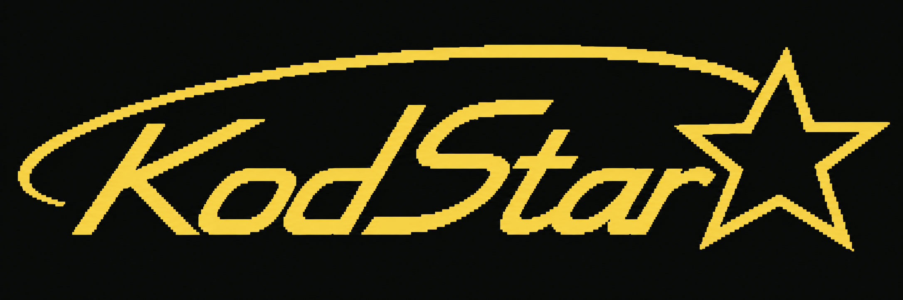

# KodStar

<p align="center">
  
</p>

KodStar is a local Rust CLI for exploring source code. It shows where a symbol is defined,
what it calls, who uses it, and how dependencies connect across a project. Queries can also
compare or read saved checkpoints. Tree-sitter extracts syntax, embedded Clang enriches C/C++
analysis, and SQLite stores source history and the analysis index.

## Quick start

Source builds run on macOS or Linux and require the pinned Rust toolchain, C/C++ build tools,
and LLVM/Clang development headers and static libraries. Follow the [build requirements](docs/development.md#개발-환경).

```bash
git clone https://github.com/keonho-kim/kodstar.git
cd kodstar
./install.sh
```

In the project you want to explore, run `kodstar init` to create local source history and the
initial index. The first run asks for confirmation because it preserves tracked source bytes
in the project's `.kodstar/` directory. For automation, use `--yes` after selecting the intended project directory.

```bash
cd /work/project
kodstar init
kodstar overview
kodstar search 'order storage' --ranked
```

Use your own file and symbol names in the examples below.

| Question | Command |
|---|---|
| What does this file define? | `kodstar symbols src/api.rs` |
| What calls this symbol, and where? | `kodstar refs src/api.rs handle_request --sites` |
| How was a connection resolved? | `kodstar explain src/api.rs handle_request` |
| How are two symbols connected? | `kodstar path 'src/api.rs::handle_request' 'src/store.rs::save' --undirected` |
| Which code might a change affect? | `kodstar impact src/store.rs save` |
| Which languages and inputs can this build analyze? | `kodstar languages` |

## Explore a saved state

Regular queries check for changes and reuse the index for the latest observed state. Use
`--no-refresh` for a query against the existing analysis, or `--rev` to select a checkpoint.

```bash
kodstar history save baseline
# Edit and save your source files.
kodstar history diff
kodstar impact --since baseline
kodstar symbols src/api.rs --rev baseline
```

Run `kodstar history diff --graph --from baseline --to NEW_CHECKPOINT` to compare relationships
between two saved states. Replace `NEW_CHECKPOINT` with the ID or name displayed by `kodstar history`.

## Use the results in tools

Use `--format json` for a single result object or `--format jsonl` for a stream. The result
includes freshness, coverage, and completion status. `kodstar serve --stdio` provides a
versioned session for tools that need multiple requests or per-request cancellation. See the
[output contract](docs/reference/output.md).

## Documentation

The detailed guides are in Korean. [Start with the documentation map](docs/README.md).

| Guide | What it covers |
|---|---|
| [Specification](kodstar-spec.md) | CLI commands, supported inputs, output contracts, and storage behavior |
| [Architecture](docs/architecture.md) | Code folders, common execution flow, and where each module starts |
| [Development](docs/development.md) | Build environment, checks, benchmarks, and dependency sources |
| [Development principles](AGENTS.md) | Design review and repository conventions |

Third-party sources and notices are recorded in [LICENSES](LICENSES). Run `kodstar --licenses`
to print the notices bundled in the executable.
