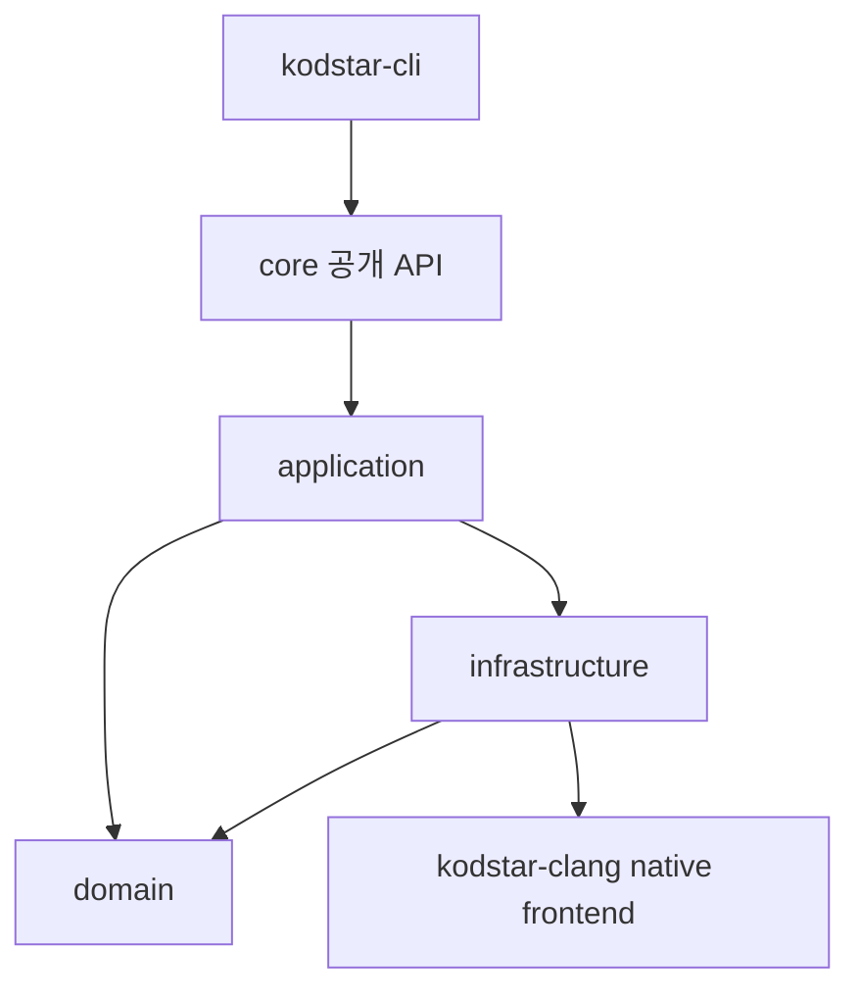
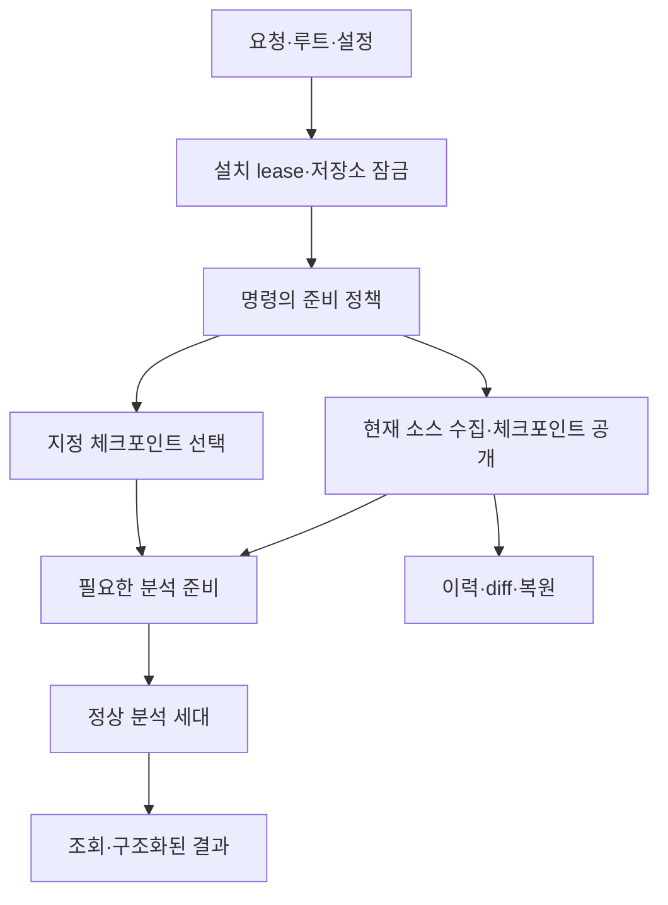

# kod<sup>☆</sup> 코드 아키텍처

이 문서는 현재 코드의 책임·의존 방향·실행과 자원 수명을 설명한다.
명령·출력·추적 범위는 [기능 명세](../kodstar-spec.md), 빌드·검증 절차는
[개발 문서](development.md), 사용법은 [README](../README.md)에서 관리한다.

## 레이어와 의존 방향



| 구성 | 책임 |
|---|---|
| `domain` | 사실·객체·관계·해석 상태·조회·이력 요청과 구조화된 결과 |
| `application` | 프로젝트 선택, 체크포인트 수집 정책, 분석·해석·조회·유지보수 조정 |
| `infrastructure` | 디스크 순회, 보존 입력, parser, 포맷, SQLite와 잠금 |
| `kodstar-clang` | 정적 Clang frontend·FFI·압축 builtin header·실행 수명 |
| `kodstar-cli` | 인자·stdio 파싱, 엔진 호출, 표시·진행·종료 코드, 설치·터미널 확인 |

공개 진입점은 [lib.rs](../crates/kodstar-core/src/lib.rs)다. CLI와 stdio worker는 같은
`Engine::execute`를 사용하며 엔진 결과는 `QuerySink`로 전달한다. text·JSON·JSONL·TSV는 CLI가 표시한다.
SQL·connection·parser 타입은 core 내부에서 사용한다.

### 구문 그래프와 선택적 의미 보강

Tree-sitter가 모든 지원 언어의 기본 선언·scope·사용 사실을 소유한다. C/C++도 먼저 같은
체크포인트에서 구문 트리를 준비하고, 내장 Clang은 해당 문맥에서 검증한 선언·호출 근거를
보강한다. SDK·컴파일 문맥 부재나 native 작업 한도로 구문 결과를 제거하지 않는다.
Clang 근거는 원문 위치·소유자·조건과 대응하는 경우에만 병합하며 다른 조건의 선언을 지우지 않는다.

```text
infrastructure/parse/extraction.rs   # 입력 디코딩·구문 추출 진입점
infrastructure/parse/hybrid.rs       # 구문 트리 우선 준비·동일 입력의 Clang 보강
infrastructure/parse/recovery.rs     # 오류 위치·복구할 선언과 불확실한 scope 판정
infrastructure/parse/conditional/    # 도달 가능한 분기 선택·구문 결과와 부분 복구 병합
infrastructure/index/failures.rs     # 실패·부분 추출 진단과 공개 세대의 연결
application/analysis/resolve/        # 복구 입력·provider의 관계를 후보로 제한
```

복구 트리의 이름·선언부·소유 범위를 확인할 수 있는 정의는 보존한다. 오류 토큰과 깨진 표현을
정상 binding·호출로 추출하지 않는다. 불확실한 scope를 거친 관계와 부분 provider의 관계는
확정하지 않고 후보·미해결로 공개한다. 원문 해석 자체가 불가능한 인코딩·입력 한도는 파일
실패로 구분한다. 진단의 변화도 증분 해석을 무효화하므로 부분 추출과 복구 후 결과는 전체 분석과 일치한다.
구문 coverage와 native 의미 보강 상태를 구분하고 native 미완료만으로 정상 구문 조회를 실패시키지 않는다.
I/O·DB·취소·worker 실행 실패의 transaction rollback과 원문 이력의 독립성은 유지한다.

### 파일 결과·입력 투영·증분 변경의 경계

실프로젝트 입력의 실패 격리와 증분 재사용은 다음 소유권으로 구성한다.

```text
domain/diagnostics/                  # 복구 가능한 입력 실패와 실행 실패 구분
domain/facts/append.rs               # 기존 바이트·사실과 새 선언의 순수 증명
domain/facts/append/                 # 단일 삽입의 원문 해시·이전 사실 대응·추가 선언 판정
domain/source/lines.rs               # 바이트 위치를 원문 줄·열로 대응하는 제한된 색인
application/analysis/workers/        # 부수 효과 없는 사전 추출·파일 결과 전달
application/analysis/routing.rs      # native 단일 소유자·일반 worker의 제한된 입력 큐
infrastructure/index/failures.rs     # 실패 파일의 불완전한 사실 제거·진단 저장
infrastructure/index/append_reuse/   # 기존 사실이 동일한 추가 선언의 증명·저장
infrastructure/index/facts/retained.rs # 보존된 행의 위치와 파생 사용 위치 갱신
application/analysis/resolve/identities/ # 언어별 정체성 계산·추가된 심볼만 재계산
infrastructure/parse/input/          # 명시적 인코딩·문법 입력과 원문 위치 대응
infrastructure/clang/configuration/ # include·define·header의 컴파일 문맥 선택
infrastructure/clang/structural.rs   # native 선언으로 증명한 매크로의 원문 투영
```

worker는 파일 추출을 검토한 뒤 writer에 사실을 전달한다. 복구 가능한 구문은 부분 추출로,
인코딩·파일 작업 한도는 해당 파일의 실패로 기록하고 다른 파일을 계속 처리한다. 실패 파일의
이전 사실을 최신으로 표시하지 않는다. I/O·DB·취소·worker 실행 실패는 전체 transaction을
롤백해 마지막 공개 세대를 보호한다. 일부 입력이 실패하거나 한도로 제외된 세대는 조회할 수
있지만 결과의 `complete`와 진단에 불완전성을 전달한다. 실패 입력이 복구되면 관련된 부정적
조회 결과도 무효화한다. 정상 원문 이력은 분석 실패와 독립적으로 보존한다.
`analysis/configurations`는 누락된 상속·참조 설정의 진단을 소유한다. 설정 문맥이 불완전하면
`resolve/javascript/configurations`가 해당 설정 그래프의 비상대 import 확정을 막는다. 상대 import와
독립된 파일의 분석은 계속하고, 설정이 복구되면 같은 갱신에서 진단과 조회 의존성을 재계산한다.
잘못된 JS/TS 설정도 사전 추출에서 파일별 입력 실패로 격리한다. 참조 설정은 저장 전에 같은
사전 검사를 수행한다. 가장 가까운 설정이 실패했거나 한도로 제외돼도 그 경계를 유지해
상위 설정·package fallback으로 대체하지 않는다. Kodstar 자체의 실행 설정 오류와 DB·I/O 실패는
이 격리 대상에 포함하지 않는다.

인코딩 adapter는 명시된 입력 형식을 해석하고 parser의 UTF-8 위치를 원문 byte 범위로 대응한다.
원문·내용 주소를 바꾸거나 인코딩을 추측하지 않는다. grammar의 문자열 내용·매크로 치환 조각은
각 입력의 역할에 맞게 다루며 완전한 독립 선언처럼 검증하지 않는다.

증분 writer는 기존 사실이 유지된다는 증거와 새 provider의 소비자를 함께 확인한다. 이름·서명·
export·소유 범위가 바뀐 경우 실패·모호한 lookup까지 포함해 소비자를 선택하고, 증명할 수 없는
변경은 전체 해석을 유지한다. 클래스가 있다는 이유만으로 무관한 선언 추가를 전역 해석으로
확대하지 않는다. scoped binding의 실행 순서와 단일 writer의 상태 소유권은 보존한다.

native 큐는 16MiB stack을 가진 한 worker만 소비한다. 이 worker는 native 작업이 없으면
일반 입력도 처리하고, 나머지 worker는 2MiB stack으로 일반 입력을 병렬 처리한다.
frontend와 AST 방문의 깊이·작업량을 각각 제한한다.
컴파일 문맥은 저장된 metadata와 허용된 인자에서 구하고, header는 소속 translation unit의
include·define 문맥을 사용한다. 분석 대상의 빌드·configure·의존성 설치를 실행하지 않는다.

## 소스 구성도

주요 책임을 표시한 구성도다. 언어별 규칙은 해당 레이어 안에서 분리한다.

저장 기능은 다음 경계로 나눈다. `index/dictionary`는 안정된 key ID와
접두어 압축 블록·검색 경로를, `index/atoms`는 공유 문자열과 참조 수명을, `index/records`는
정수 행·바이너리 식별자와 논리 열을, `index/relations`는 관계 블록·공유 후보 정보·역방향 경로와 변경을 소유한다.
공통 `index/packed`는 SQLite 검색 조건과 제한된 블록 cursor만 연결한다. 전체 사전이나 관계를
상주시키지 않으며 transaction 안의 변경을 같은 connection에서 읽는다.
`history/content`는 원문 청크·codec·읽기·내용 기반 분할을,
`history/maintenance`는 명시적 형식 전환·기존 내용 재압축·검증을,
`history/checkout`은 복원 journal·파일 공개를 소유한다.
검증 스크립트는 `scripts/checks`, 측정·독립 decoder는 `scripts/benchmarks`,
고정 grammar 생성은 `scripts/grammars`에 둔다.

```text
install.sh                                  # 임시 CLI 빌드·종료 시 정리·사용자 설치 진입
.config/
├── nextest.toml                            # 테스트 격리·실행 수·native 그룹·시간 제한
├── insta.yaml                              # 일반 검사에서 스냅샷 자동 갱신 금지
└── deny.toml                               # 의존성 라이선스·출처·보안 검사 정책
.cargo/mutants.toml                         # 압축 정수 codec의 선택 변이 검사
crates/kodstar-core/src/
├── lib.rs                                  # 공개 API와 지원 플랫폼
├── domain/
│   ├── facts.rs                            # scope·정의·binding·사용 사실
│   ├── facts/fingerprint.rs                # 사실·lookup 환경 fingerprint
│   ├── facts/append/                       # 원문·사실 대응으로 단일 선언 삽입 증명
│   ├── source/lines.rs                     # 원문 바이트의 제한된 줄·열 색인
│   ├── symbols.rs                          # 객체와 정의 위치
│   ├── relations.rs                        # 관계·방향·해석 상태
│   ├── resolve/lookup_keys.rs               # package·정규 module·경로 후보의 의존성 key
│   ├── query.rs                            # 선택자·탐색 옵션
│   ├── history.rs                          # 이력 요청·결과·이름 규칙
│   ├── web/                                # HTTP 앱·경로·등록 값과 순수 비교 규칙
│   ├── resolve/native.rs                    # USR와 실제 선언 위치의 구조화된 근거
│   ├── native.rs                            # native 입력 관측·완료 상태·제한 원인의 값
│   └── results.rs                          # 결과·metadata·sink
├── application/
│   ├── engine.rs                           # 공개 엔진 호출
│   ├── workspace/                          # 루트·설정 선택
│   ├── execution/
│   │   ├── mod.rs                          # CommandHandler 실행 순서
│   │   ├── context.rs                      # 동기화와 실행 자원 수명
│   │   ├── state.rs                        # 최초·진단 의도와 현재·watch·revision 상태
│   │   ├── prepare.rs                      # 현재·과거 분석 준비
│   │   └── history.rs                      # 체크포인트 이력 명령
│   ├── history/
│   │   ├── capture.rs                      # 추적 상태 수집·체크포인트 공개
│   │   ├── capture/catalog.rs              # 수집 수명의 이전 상태·관찰 행 SQL
│   │   ├── listing.rs                      # 이력·브랜치 순회
│   │   ├── compare.rs                      # 체크포인트 선택과 소스 비교
│   │   ├── graph/                          # 두 그래프의 관계 집계와 차이 투영
│   │   ├── text.rs                         # 제한된 텍스트 차이 표시
│   │   ├── text/                           # 스트리밍 UTF-8 검증·변경 구간·한 행 표시
│   │   │   └── alignment.rs                # 바이트·행 한도 안의 similar 행 정렬·동일 행 제외
│   │   ├── branches.rs                     # 브랜치 상태 전이
│   │   ├── impact.rs                       # 변경 전후 분석과 영향 시드
│   │   └── impact/rows.rs                  # 양쪽 결과의 전체 출력·방문 한도
│   ├── query/                              # 선택·관계 조회·디스크 탐색
│   │   ├── overview.rs                     # 디렉터리·패키지 집계와 파일 순환
│   │   ├── ranked.rs                       # 단어 일치 순위와 후보의 직접 연결
│   │   ├── documentation.rs                # 분석 세대 기준의 문서 근거 위치
│   │   ├── relationship_rows.rs            # 제한된 fact 복원과 불변 심볼 공유
│   │   ├── relationship_rows/batch.rs      # 선택한 관계의 fact·객체 배치 선취
│   │   └── traversal/                      # 순서·한도와 메모리/디스크 탐색 연결
│   │       ├── graph.rs                    # petgraph의 제한된 방향별 발견 집합·이웃 view
│   │       ├── memory.rs                   # 깊이별 정렬 BFS·디스크 frontier로 상태 전달
│   │       ├── disk.rs                     # 디스크 frontier·부모 경로와 이웃 확장
│   │       ├── undirected.rs               # 단계별 방향을 보존하는 최단 경로
│   │       ├── order.rs                    # 계층별 배치 조회·경로 공유·정렬
│   │       └── visited.rs                  # 제한된 방문 집합과 디스크 전환
│   ├── analysis/
│   │   ├── mod.rs                          # 정상 분석 재사용·갱신 transaction·세대 공개
│   │   ├── discovery.rs                    # 보존 입력의 변경 판정·작업 전달
│   │   ├── incremental/inputs.rs           # 정상 분석 체크포인트의 차이·탐색 범위 선택
│   │   ├── native_inputs.rs                # 파일·누락 경로·디렉터리 변화의 소비 파일 선택
│   │   ├── pipeline.rs                     # producer·worker·writer 조정
│   │   ├── pipeline/writer.rs              # 파일 이벤트 저장·본문 재사용·분석 진행
│   │   ├── resources.rs                    # 분석 단계 단일 native 문맥·stack 예약
│   │   ├── routing.rs                      # native 큐와 일반 큐의 취소·종료·입력 배정
│   │   ├── resolve/prepared/dependencies.rs # expression 의존성의 제한된 배치 기록
│   │   ├── budget/model.rs                 # permit 총량·반납·대기 해제의 제한된 Loom 모델
│   │   ├── pipeline/start.rs               # 파일 교체·본문 재사용과 변경 집합 준비
│   │   ├── workers.rs                      # parser·취소·파일별 추출
│   │   ├── batches.rs                      # 바이트 예산 내 fact 전달
│   │   ├── replay.rs                       # 작은 변경 파일의 제한된 사실 재사용
│   │   ├── positions.rs                    # 같은 사실의 scope 끝 위치를 제한된 예산으로 수집
│   │   ├── incremental.rs                  # 필요 시 한 번 읽는 환경과 재사용 조건
│   │   ├── configurations.rs               # 참조된 설정 분석
│   │   ├── configuration_input.rs          # 공유 snapshot reader의 설정 사실 추출
│   │   ├── module_identity.rs              # 보존 manifest의 package·module 식별
│   │   └── resolve/                        # 언어별 이름·모듈·타입·관계 해석
│   │       ├── fact_batch.rs               # cursor 종료 후 해석하는 제한된 사실 배치
│   │       ├── preparation.rs              # 존재하는 언어·owner hint의 준비 단계 선택
│   │       ├── identities/                 # 언어별 정체성·추가 심볼의 부분 준비
│   │       ├── reuse.rs                    # 작업 수명의 동등 lookup·의존 근거 재사용
│   │       ├── http/                       # Hono 등록 근거·HTTP 요청·렌더링 대상 해석
│   │       ├── clang.rs                    # native 의미 근거와 인덱스 객체 대응
│   │       ├── ruby/                       # instance·singleton 방향과 동적 조회 제한
│   │       └── modules/candidates.sql      # export 후보의 이름·가시성·소유 범위 선택
│   ├── cache.rs                            # 명시적 캐시 정책
│   ├── maintenance.rs                      # 자동 GC 정책
│   └── installation.rs                     # 초기화 대상·설치 lease·데이터 제거 API
└── infrastructure/
    ├── scan/mod.rs                         # 이력 수집용 디스크 파일·symlink 순회
    ├── scan/policy.rs                      # 순회·감시의 기본 제외와 명시 패턴
    ├── history/
    │   ├── mod.rs                          # 영구 DB·형식·잠금
    │   ├── changes/                        # 두 체크포인트의 경로별 최종 변화와 제한된 계보 순회
    │   ├── schema.sql                      # 내용·이력·작업 catalog·복원 journal
    │   ├── content/                        # 원문 내용의 주소·분할·인코딩·읽기
    │   │   ├── blobs/                      # 원문 단일 읽기·내용 주소·중복 판별
    │   │   ├── chunks.rs                   # 공유 주소·물리 표현 선택
    │   │   ├── chunks.sql                  # 공유 내용·blob 참조·논리 view
    │   │   ├── chunking.rs                 # 제한된 내용 기반 경계
    │   │   ├── encoding.rs                 # 제한된 Zstd level 1·깊이 1 dictionary 델타
    │   │   ├── chunk_read.rs               # 주소·크기·개행 검증과 제한된 기준 청크 재사용
    │   │   ├── chunk_read/cache.rs         # metadata·압축 payload 내용 ID로 검증 결과 재사용
    │   │   ├── reader.rs                   # 가변 경계 검색·마지막 청크 보유
    │   │   └── chunk_ranges.rs             # 같은 내용 구간 검색
    │   ├── maintenance/                    # 명시적 전환·재압축·무결성
    │   │   ├── mod.rs                      # 알려진 schema·전환·VACUUM 경계
    │   │   ├── legacy.rs                   # 형식 1·2·3의 스트리밍 변환
    │   │   ├── compressed.rs               # 형식 4 원문·주소를 보존하는 Zstd 전환
    │   │   ├── metadata/                   # 경로·해시·이전 상태의 명시적 형식 전환
    │   │   ├── prior_encoding.rs           # 명시적 전환에서만 사용하는 형식 4 decoder
    │   │   ├── repack.rs                   # 제한 후보·독립 기준 재선택·rollback
    │   │   └── verification.rs             # 저장 참조·보존 바이트 확인
    │   ├── inputs/                         # 체크포인트 순회·제한된 분석 입력
    │   ├── checkpoints.rs                  # 시점 선택·파일 구성·이름
    │   ├── checkpoints/materialize.rs      # 가까운 시점 양방향 적용·먼 시점 재구성
    │   ├── metadata.sql                    # 공유 경로·정수 속성·이전 파일 상태
    │   ├── checkout/                       # 복원 journal·충돌·파일 공개
    │   │   ├── mod.rs                      # 복원 계획·재개·참조 공개
    │   │   ├── checks.rs                   # 충돌·완료 파일·장치 검사
    │   │   ├── files.rs                    # staging·rename·fsync
    │   │   └── tree.rs                     # 파일·디렉터리 전환
    │   └── paths.rs                        # 상대 경로·저장 파일 검증
    ├── clang/                              # 체크포인트 VFS·compile 문맥·native 사실 대응
    │   ├── inputs.rs                       # 고정 입력과 존재/부재 관측의 실행 수명
    │   ├── inputs/catalog.rs               # 체크포인트 고정 metadata의 제한된 파일 간 공유
    │   ├── configuration.rs                # 실행하지 않는 compile command 경계 파싱
    │   ├── configuration/database.rs       # worker 수명의 고정 compile database 색인
    │   └── projection.rs                   # 검증된 native 선언·호출을 구문 사실에 대응
    ├── languages/                          # 공식 grammar 선택·capability
    ├── parse/                              # 언어별 사실 추출·파일 내 재사용·parser 수명
    │   ├── javascript/hono/                # 앱 생성·라우트·handler·응답의 AST 근거
    │   ├── walk.rs                        # 검증된 AST의 반복 순회와 추출 문맥
    │   ├── context.rs                     # 공유 이름 경로·작은 이름 조각·렌더링 작업 배열
    │   ├── input/                         # 문법별 입력 표현·원본 바이트 위치 보존
    │   └── conditional/                   # 전처리 분기·분석용 투영·조건을 보존하는 결과 병합
    │       └── choices.rs                 # coverage를 확인한 지연 투영 후보·바이트 예산
    ├── formats/
    │   ├── markup.rs                       # 웹 adapter가 공유하는 원본 속성 범위·문자 참조
    │   ├── htmx/                           # HTML·템플릿·JSX의 정적 HTTP 속성 추출
    │   ├── auxiliary/                      # manifest·설정 입력
    │   ├── xml/                            # 읽기 전용 XML 문서의 속성·원문 범위·위치 색인
    │   ├── dotnet.rs                       # XML 요소의 SDK·Compile 항목·상위 조건
    │   └── components/                     # 혼합 코드 영역·원본 위치 대응
    ├── index/                              # 분석 DB·사실·조회 의존·객체 복원·통계
    │   ├── native.rs                       # 의미 사실과 독립적인 native 관측·진단 교체
    │   ├── cached.rs                       # 해석 SQL의 제한된 재사용 풀
    │   ├── body_reuse/                     # 같은 선언 환경의 호출 fact를 제한된 hash·ID journal로 대조
    │   ├── atoms/                          # 공유 문자열·정확한 참조 계수·제한된 writer cache
    │   ├── records/                        # 네 분석 행의 정수 schema·논리 view·쓰기 제약
    │   ├── dictionary/                     # 접두어 사전·정렬 병합·안정 ID·회수·검증
    │   │   └── routing/                    # 128개 ID의 run-length 페이지·범위 참조 보호
    │   ├── dependencies/                   # 의존성 블록·선택 fact 교체·논리 view·검증
    │   │   ├── pages/                      # 여러 희소 lookup을 묶는 제한 페이지·논리 행 adapter
    │   │   ├── read.rs                     # 중복 key 소비자의 직접 정수 decode
    │   │   ├── selection.rs                # 부분 재해석할 이전 소비의 그룹 선택
    │   │   ├── publication.rs              # 새 전체 결과·부분 결과의 실행 경로 선택
    │   │   └── writer.rs                   # 변경된 블록만 대조·병합
    │   ├── relations/                      # 관계 행·검증·선택 복원·블록 갱신
    │   │   ├── prior.rs                    # 동일한 부분 해석 결과의 ID 재사용·예약
    │   │   ├── reconcile.rs                # 새 결과에서 사라진 관계의 블록별 회수
    │   │   ├── addresses.rs                # 연속 관계 ID 구간의 검색·차이 공개
    │   │   ├── groups.rs                   # 블록의 ID·fact 연결과 제한된 후보 그룹 읽기
    │   │   ├── reader.rs                   # snapshot 안의 제한된 블록·설명 읽기
    │   │   ├── sets/                       # 큰 후보 정보의 공유·참조 수명·검증
    │   │   ├── routing/                    # 역조회 차이값 페이지·원자적 변경·cursor 수명
    │   │   └── merge.rs                    # 기존 source 블록의 빈 자리 병합
    │   ├── packed/                         # SQLite 조건 전달·빌린 값·한 블록 cursor
    │   │   ├── expansion.rs                # 압축 정수 목록의 JSON 없는 SQL 행 순회
    │   │   └── statements.rs               # virtual table 내부의 작은 고정 SQL 재사용
    │   ├── inert_inputs.rs                 # 이력 전용 입력 변경 판정
    │   ├── failures.rs                     # 파일 실패·조각 진단과 불완전한 사실 제거
    │   ├── append_reuse/                   # 증명된 삽입의 기존 행·관계 보존
    │   ├── facts/retained.rs               # 보존 행·파생 위치를 삽입 후 좌표로 이동
    │   ├── statistics.rs                   # 의미 변경 범위에 따른 통계 공개
    │   ├── statistics/delta.rs             # 제한된 fact 집합의 이전·이후 통계 차이
    │   ├── statistics/inputs.rs            # 파일 상태·고유 객체의 transaction 차이 집계
    │   ├── display_path.rs                 # 원래 경로 바이트에서 표시 문자열 계산
    │   ├── adjacency.rs                    # 정점 ID로 직접 찾는 이름·위치·경로 projection
    │   ├── invalidation.rs                 # 갱신 전 소비 fact 보존·부분 해석 준비
    │   └── invalidation/static_modules.rs  # 정적 함수 모듈의 조건·provider key 선택
    ├── cache/                              # cache 등록·lease·catalog·안전한 삭제
    └── installation/                       # 영구 프로젝트 등록부·설치 lease·제거
crates/kodstar-clang/
├── build.rs                                # 고정 toolchain과 builtin 리소스 생성 연결
├── build/                                  # 개발 입력 검증·정적 archive·파일별 압축
│   └── compression.rs                      # 제한된 학습 표본·공용 dictionary·순이득 선택
├── native/                                 # frontend·가상 파일시스템·AST visitor·C ABI
└── src/
    ├── lib.rs                              # 안전한 동기 실행·FFI 수명
    ├── callbacks/input.rs                  # 입력 버퍼 전달·회수
    ├── facts.rs                            # 정수 문자열 key의 사실과 빌린 view
    ├── text.rs                             # 파일별 이름·USR·경로 사전
    └── headers.rs                          # 내장 헤더 조회·단계 수명의 복원 context
crates/kodstar-cli/build.rs                  # 라이선스 원문의 빌드 전용 압축 자산
crates/kodstar-cli/src/
├── args/                                   # 명령·인자와 짧은/상세 도움말
│   ├── options.rs                          # 공통 옵션·기본값 안내·입력 파싱
│   ├── queries.rs                          # 조회 명령·탐색 정책 안내·예시
│   ├── history.rs                          # 이력·브랜치 명령·부수 효과 안내·예시
│   └── tests.rs                            # 공개 도움말 누락·예시 인자 검증
├── invocation/                             # 입력을 엔진 요청으로 변환
├── run.rs                                  # 프로세스·엔진 실행 연결
├── telemetry.rs                            # --verbose에 따른 tracing subscriber 수명·stderr 출력
├── confirmation.rs                         # 최초 경로·제거 확인
├── output/                                 # 형식별 표시·진행
├── session/                                # stdio 요청 수용·worker·결과 전송
│   ├── output.rs                           # 결과·제어 프레임의 제한된 queue·permit
│   ├── frame.rs                            # 64KiB 메모리·큰 프레임 spool·RAII 회수
│   └── transport.rs                        # 취소 가능한 단일 stdout writer·fd 복원
└── installation/                           # receipt·실행 파일·PATH 등록과 제거
scripts/
├── benchmarks/                             # 분석·이력 측정과 독립 기준 decoder
├── checks/                                 # 소스 규칙·설치·대화형 확인·stdio session 검사
└── grammars/                               # 고정 공식 grammar 소스·패치 재생성·출처 검사
crates/kodstar-core/benches/                 # Criterion의 실제 엔진·이력 작업 측정
crates/kodstar-core/tests/cases/
├── consistency.rs                          # 초기 색인 차단·세대 공개와 실패 일관성
├── refresh_reuse.rs                        # 무변경 분석·검증 갱신의 재사용 계약
├── module_incremental.rs                   # 제공 파일 변경과 성공·실패 모듈 lookup 갱신
├── history_streaming.rs                     # 저장 diff fixture·청크·UTF-8·스트리밍 범위
└── history_alignment.rs                     # 정렬된 행·LF 경계·정렬 예산의 공개 결과 검증
crates/kodstar-core/tests/support/packed_mutations.rs # 물리 ID·scope 변경과 보존 관측 fixture
crates/kodstar-cli/tests/snapshots/           # 검토해 보존한 공개 도움말 계약 fixture
```

개발 도구는 배포 CLI와 별도로 설치하고 Cargo 하위 명령으로 직접 실행한다.
버전·실행·임시 출력 정리 절차는 [개발 문서](development.md#개발-품질-도구)가 소유한다.
rstest와 insta는 CLI 테스트의 사례 선택과 출력 계약을,
Loom은 실제 ByteBudget의 잠금·조건 변수로 permit 경합과 반납을 검사한다. `kodstar_loom`은
선택한 library 테스트에만 적용하는 계측 설정이다. 모델은 제한된 실행 순서를 탐색하며,
취소 타이머·운영체제 신호·native FFI 검증은 기존 통합 테스트가 담당한다.
스냅샷은 버전 관리하는 테스트 입력이며 검사 중 자동 갱신하지 않는다.
측정·변이·커버리지의 빌드 출력과 임시 복사본은 실행별 임시 경로에 두고 명령 종료 후 제거한다.

CLI 인자가 기본 true인 `--verbose true|false`를 소유한다. main은 같은 값을 `telemetry`와
renderer에 전달한다. 상세 출력이 켜졌을 때 subscriber를 만들고 main의 guard가 수명을 유지한다. stdio는
dispatcher를 작업 thread로 전달하고 join이 끝난 뒤 guard를 해제한다. application의
명령 준비·동기화·수집·추출·해석·조회 span은 시간과 개수만 기록한다. core는 subscriber를
설치하지 않는다. renderer는 상세 출력이 꺼져도 제한·미완료 진단을 표시한다. 계측은
stdout·stdio progress frame·영구 저장 형식·분석 결과를 변경하지 않는다.

### 웹 요청과 native 의미 분석

HTTP 경로·메서드와 정적 경로 결합은 domain의 `web` 모듈이 소유한다. Hono 추출기는
실행 없이 앱 생성·라우트 등록·handler와 응답 표현을 기존 fact·binding으로 전달한다.
`resolve/http`는 실제 import·lexical binding으로 Hono 근거를 확인하고 메서드·경로별
임시 인덱스로 요청 대상을 찾는다. 여러 앱·경로 패턴·동적 구문을 단일 실행 대상으로
확정하지 않는다. HTML은 웹 입력 형식으로 인식하며 htmx 속성은 혼합 입력의 코드·주석·
문자열 경계를 지킨다. 소스와 원본 위치를 유지하고 요청 대상의 부재도 재해석한다.
모듈 파일 조회가 해당 깊이의 후보·owner 작업 공간을 초기화한다. 호출자가 이전 조회를
정리했는지에 따라 결과가 달라지지 않으며 재귀 분기는 다른 깊이를 사용한다.

`crates/kodstar-clang`은 공식 Clang의 정적 링크, FFI, native AST와 압축한 builtin header의
수명을 소유한다. `native/`의 C++ 파일은 frontend·VFS·사실 방문으로 나누고 build 입력의
버전과 출처를 고정한다. header와 입력은 메모리에서 제공하며 보조 실행 파일·런타임을
추출하지 않는다. core adapter가 native 근거를 기존 객체·호출 사실에 대응시키고, 컴파일
환경·입력이 부족한 경우 의미 분석 실패를 진단한다. native 사실과 그 입력 의존성은
체크포인트의 바이트를 기준으로 하며 기존 소스 이력의 수명과 분리한다.
compile argument 파서는 최적화·thread flag가 만드는 전처리 문맥도 전달한다. native 전처리
callback은 시간 의존 builtin 확장을 거절해 소스의 진단 pragma로 재사용 조건이 바뀌지 않게 한다.

native callee는 USR만으로 프로젝트 전체의 동명 구현에 연결하지 않는다. 실제 선언 파일·위치와
include 도달·충돌을 함께 확인하며 조건부 선언은 기존 후보 정책을 따른다. `native_inputs`는
보존 delta와 include·실패 경로 소비 색인으로 재파싱 대상을 더한다. 바뀐 호출의 native 근거는
본문 환경 fingerprint에서 분리하고, 재사용 journal의 15번째 정수 필드로 실제 callee를 대조한다.
같은 구문 위치에서 인자만 바뀌어 overload가 달라져도 호출 결과를 재해석하며 무관한 사실은 유지한다.

native 입력 관측과 완료 상태는 `domain/native`의 값으로 전달하고 `index/native`가 별도로
저장한다. lexical binding과 의미 fingerprint에는 넣지 않는다. worker는 의미 사실을 재사용하는
경우에도 같은 transaction에서 관측을 교체한다. 파일 해시·디렉터리 존재·실패 경로를 구별하고,
변경 경로와 조상 경로의 소비자를 선택한 뒤 실제 관측값이 달라졌을 때만 다시 파싱한다.
따라서 include의 공백 변경은 입력 관측을 갱신하지만 동일한 선언·호출의 관계를 초기화하지 않는다.
같은 파일의 매크로·조건부 구문 재파싱은 syntax tree 재사용만 초기화한다. native 결과와 입력
관측은 worker의 실제 파일 종료에서만 해제해 사전 fingerprint pass와 전체 추출의 수명을 같게 한다.

전체 메모리 설정은 동시에 살아 있는 자원을 위한 scheduling 경계다. 수집·파싱/의미 분석·관계
해석·공개·조회는 각 단계의 소유 자원을 사용하며 완료한 단계의 작업 버퍼를 다음 단계에 유지하지 않는다.
`analysis/resources`는 입력·queue·DB와 worker stack의 예약을 제외한 native 작업 공간을 정한다.
`analysis/routing`의 제한된 native 큐는 16MiB stack의 단일 worker가 소비한다. 나머지 worker는
2MiB stack으로 일반 입력을 처리한다. native worker도 대기 중 일반 입력을 처리하며 파일별
작업 공간을 해제한다. 모든 worker와 파싱 자원은 관계 해석 전에 종료한다. 명령 전체에 누적하는
작업량 제한은 없다. stack 예약은 분석 단계에서 확인하므로 작은 예산의 기존 결과 조회를 막지 않는다.

native 입력·결과 바이트와 토큰·template 작업 수는 각각 파일 작업의 한도다. 토큰·template 한도는
메모리 바이트 수에서 계산하지 않는다. `native/budget.h`는 Clang의 AST·전처리·소스 buffer 사용량도
관측하고 task에 배정한 메모리와 비교한다. 이 값은 OS RSS hard limit과 구별한다. 제한 원인과
사용량·한도, 첫 compiler 오류를 보존한다. compile command는 셸로 실행하지 않고 인자 값으로만 파싱한다.
프로젝트 밖 SDK가 필요한 문맥은 내장 builtin header만으로 완전하다고 표시하지 않는다.
compile database는 worker의 고정 snapshot 수명에서 한 번 파싱하고 파일별 명령을 선택한다.
`arguments`와 quote를 해석한 `command`를 같은 허용 flag 경계로 전달한다. 내장 표준 헤더는
LLVM과 같은 버전의 libc++, 고정 Zig 배포본의 대상별 C 헤더를 원문 그대로 사용한다.
macOS의 Darwin C 헤더와 libc++는 compiler builtin 헤더와 별도 메모리 경로로 제공하며,
내용 ID·target·ABI 설정이 분석 환경 key에 포함된다. 프로젝트별 생성 헤더와 framework SDK는
이 리소스 집합에 포함되지 않는다.

진행 이벤트는 domain의 `Progress`가 단계·현재 파일·설명을 전달하고 CLI가 stderr에 표시한다.
단계 전환·native 미완료/제한 진단은 터미널 여부와 무관하게 표시하며 파일 진행은 빈도를 제한한다.
stdout의 결과 envelope와 stdio session의 구조화된 progress frame은 각 transport가 소유한다.

### 구문 입력과 조건부 컴파일

공유 `.h`의 언어 판별은 `languages/header.rs`가 소유한다. 주석·문자열을 건너뛰며 분석할
전체 본문의 C++·Objective-C 구문을 확인한다. discovery는 변경된 크기 한도 내 헤더의 원문을
기존 입력 예산으로 한 번 읽고, 같은 버퍼를 판별과 worker에 넘긴다. 내용 해시가 같은
헤더는 저장된 언어를 재사용한다. 크기 한도 밖의 파일과 확장자 없는 입력의 접두부 판별은
기존 제한을 유지하며 원문 버퍼를 추가로 보관하지 않는다.

원본 파일과 영구 이력은 바꾸지 않는다. `parse/input`은 주석·문자열 등 언어가 정의한
입력 표현을 parser가 소비할 수 있게 준비하고 원본 바이트 위치를 유지한다. 코드와 이름의
해석에 필요한 인코딩을 추측하거나 유효하지 않은 입력을 대체 문자로 조용히 변환하지 않는다.
Python·Ruby의 명시적 단일 바이트 인코딩은 엄격히 디코딩하고 parser 위치를 원문에 대응한다.
지원하지 않는 선언·잘못된 바이트는 파일 진단으로 남긴다. 원문 이력은 디코딩하지 않는다.
AST 방문자는 최대 1,024단계의 기존 문맥 스택에 현재 노드를 함께 보관한다. 참조·타입 추출에
직접 부모를 전달해 노드마다 Tree-sitter의 루트 기반 부모 탐색을 반복하지 않는다. 노드 참조는
한 tree의 순회 수명에만 남고, 도메인 문맥·파일 간 재사용 상태에는 저장하지 않는다.
파일 네임스페이스에는 같은 스택의 최상위 여부를 전달하고, C#·PHP에서만 해당 처리를 실행한다.

조건부 컴파일의 선언·타입·본문 조각은 `parse/conditional`이 소유한다. directive scanner는
줄 연결과 여러 줄 주석을 구문 경계로 읽고 위치를 보존한다. 분기를 임의로
제외하지 않고 조건을 붙인 분석용 투영과 중복 제거로 각 소스 영역의 구문 사실을 보존한다.
AST 파일 루트의 시작 위치는 첫 코드의 조건을 소유하지 않는다. 조건은 실제 선언·구문 노드에만
적용해 첫 분기의 조건이 뒤쪽의 독립된 선언으로 전파되지 않게 한다.
조건의 미지정 값은 false/true 두 기본 조합으로 탐색한다. 구문이 성립한 투영들로 실제 코드가 있는
각 도달 가능한 영역을 모두 덮어야 공개한다. 성립하지 않는 조합을 버렸다는 이유만으로 해당 영역을
누락하지 않는다. 먼저 구문이 성립한 투영을 선택하고, 그 투영으로 덮지 못한 영역은 오류 복구
투영으로 추가해 부분 상태를 기록한다. 모든 컴파일 설정의 의미를 열거하거나 전처리 매크로를
평가하는 계약은 아니다. 선택 결과는 작은 ordinal만 보관하고 AST·복제 원문은 투영 사이에 해제한다.
작업 한도는 파일 실패로, 복구 구문은 부분 coverage로 구분한다. 취소는 세대 전체를 롤백한다.
조건 이름은 계획에서 한 번 보관한다. `choices.rs`는 전역 false/true 두 조합을 먼저 시도하고,
그 뒤 분기별 만족 조합의 미지정 값을 false/true로 채운 후보를 지연 생성한다. 이미 덮은 영역만
포함하는 후보는 소스 복제와 parser 실행 전에 제외한다. 실제 실행한 조합만 작은 불리언 배열로
중복 검사하며 개수와 바이트 예산을 함께 제한한다. parser가 소비할 한 투영의 조건 맵만 보관한다.
병합 메모리 예산을 넘으면 해당 파일의 key만 전용 SQLite 임시 DB로 옮긴다. 16KiB 청크로
정규 key를 기록하고 BLAKE3 후보를 실제 전체 바이트로 다시 비교한다. DB page cache와
총 page 수도 제한하며 connection 종료·오류·취소에서 임시 DB가 제거된다.
spill의 고정 SQL 네 개는 같은 connection의 크기 제한 statement cache에서 재사용한다.
전처리기나 분석 대상의 코드·빌드 스크립트는 실행하지 않는다. 매크로의 정적 구문과 실제
확장 결과를 구별하며 증명하지 못한 대상은 기존 unresolved 계약으로 남긴다.

native 매크로 호환 처리는 파싱 실패 또는 클래스 생성자가 아닌 대문자 매크로 블록에서 적용한다.
완전한 선언과 선언부 범위를 보호하면서 구조 매크로의 경계만 동일 길이로 표시하고, 그 표식을 grammar가
별도의 불투명 매크로 노드로 읽는다. 원문에서 온 내부 표식의 거부는
`input/native_validation.rs`가 소유하며 표식 선택·어휘 보정과 분리한다.
`input/native_session.rs`는 같은 parser 자원에서 수행하는 native 입력 보정·재파싱의 유한한 반복을 소유한다.
구조 표식을 먼저 반영해 상위 블록을 복원한 뒤, 새 AST에서 선언 수식어를 판단한다.
`input/native_ranges.rs`는 겹친 근거 구간의 정규화와 포함 판정을 소유한다.
`input/native_types.rs`는 타입 선언의 이름을 수집해 정상 타입이 수식어로 변형되지 않게 보호한다.
`input/native_definitions.rs`는 오류 복구 AST에 가려진 함수형 `#define`의 이름을 원문에서
수집한다. 이름·어휘 경계만 사용하며 본문을 실행하거나 확장하지 않는다. 알려진 독립 호출은
잘못 중첩된 매개변수 AST에서도 함께 보정하고, 초기화 목록과 함수 뒤 수식어는 별도로 유지한다.
실제로 바뀌는 표식만 반영하며 보정·재파싱은 8회 이내로 제한한다.
구조 호출과 선언 수식자는 서로 다른 표식을 사용해 경고 지시 매크로가 다음 선언의 타입으로
묶이지 않게 한다. 두 표식 모두 원본 위치와 이름을 바꾸지 않는다. 미확장 매크로가
이름·소유권을 바꿀 수 있는 파일은 진단을 남기고 관련 해석을 candidate 이하로 제한한다.
소문자 독립 호출의 누락된 세미콜론은 확정된 구문으로 간주하지 않는다. parser는 임시 매크로
요구 binding을 기록하며, `resolve/native_macros/requirements.rs`가 같은 파일 또는 인덱스의
관측된 include 경로에서 함수형 정의를 확인한다. 확인할 수 없으면 해당 파일을 부분 분석으로
진단하고 관계를 후보로 제한한 세대를 공개한다. 조건부 include도 후보 검증에만 사용하고
기존 확정 include 해석은 넓히지 않는다. 헤더 변경·삭제 때도 같은 검사를 수행해 오래된
정의에 의존한 확정 관계를 남기지 않는다. 정의의 존재 확인은
전처리 조건 평가나 매크로 확장 결과의 증명을 뜻하지 않는다.

공식 grammar는 원본 revision·라이선스·입력 checksum과 생성기 버전을 고정한다.
구문 보정은 원본 grammar·scanner의 기록된 패치로 재생성하며 생성된 C parser를 직접 고치지 않는다.
`scripts/grammars`가 입력·패치·결과 checksum을 검증한다. 보존한 upstream 소스와 생성 C·JSON은
재현성과 원본 대조를 위해 파일 크기 제한에서 제외하고, 작성한 adapter·패치 도구에는 제한을 적용한다.

CLI 도움말은 `args.rs`와 `args`의 소유 명령에 정의한다. `-h`는 요약, `--help`는 상세 동작·
제약·예시를 표시한다. 공통 옵션은 엔진의 공개 기본값과 관계 목록을 사용하며 설정 파일을 읽지 않는다.
도움말·버전 파싱은 `Invocation`과 엔진 생성 전에 끝나므로 프로젝트 초기화·동기화를 실행하지 않는다.

scope 끝만 바뀐 파일은 호출·binding의 위치와 정의를 모두 대조한 뒤 수집한 scope 끝과
파일 정의의 위치를 같은 transaction에서 갱신한다. 끝 위치 수집은 기존 worker 배치 예산을
replay와 나누며 한도를 넘으면 일반 갱신 경로를 사용한다. 범위 재사용은 체크포인트 수집을 생략하지 않는다.
호출 값의 후보 필터는 후보 ID와 binding의 정수 kind를 기존 인덱스로 조회한다.
Ruby dispatch 방향은 한 fact의 Lookup 수명에 보관한다. 동적 조회 제한 표식의 전역 존재 여부는
추출이 끝난 한 해석 작업의 Prepared 수명에서 지연 판정한다. 표식 종류는 준비·해석 중 바뀌지 않으며, 후보 집합에 의존하는
소유자·파일 표식은 현재 후보와 binding 인덱스로 재평가한다. 판정은 다음 세대에 넘기지 않는다.

검색은 언어별 이름 규칙을 적용하기 전에 정수 이름 ID로 후보를 제한한다. 대표 객체 대응이
없는 snapshot은 중복 제거 window를 생략하고, SQL 결과 한도는 잘림 판정에 필요한 한 행을
포함한다. 관계 탐색은 작업이 소유하는 기존 제한 SQL 풀에서 statement를 재사용하며 허용 관계를 다시 연결하지
않고 방문 순서·경로 선택·한도를 보존한다. SQLite 내부의 반복 JSON 처리는 내장 JSONB를
사용하고 외부 결과는 기존 JSON 계약을 따른다. 큰 stdio 프레임은 고정 크기 파일 버퍼를 거쳐
익명 spool에 기록하고 전송 전에 flush·rewind한다.

`parse`의 언어 모듈은 구문 사실을, `analysis/resolve`의 언어 모듈은 이름·모듈·멤버 선택을 담당한다.
반복 모듈 조회는 공유 문자열의 정수 ID로 언어·package·module 후보를 먼저 제한한다.
Rust·C/C++ 모듈 이름도 정규화한 이름 ID로 좁힌 뒤 기존 namespace·가시성·소유 범위 조건을 적용한다.
C++ namespace의 저장 이름은 이미 `::`로 정규화되어 있다. `resolve/namespaces/cxx.rs`는
qualified 이름의 정수 ID와 기존 인덱스로 선언 확인·파일 후보를 선택하고, 다른 언어의 이름
정규화 규칙은 기존 소유자에 둔다. 문자열 치환을 모든 심볼에 반복하는 조회는 사용하지 않는다.
일반 재수출 binding의 존재 여부는 현재 해석 작업의 Prepared가 소유한다. 해당 종류가 없으면
재수출 조회·scope snapshot을 만들지 않고 기존 컴포넌트 기본 대상 판정만 수행한다. 이 값은
다음 갱신에 넘기지 않는다.
멤버 탐색은 전체 정체성 view를 lookup마다 구체화하지 않는다. 대표 객체와 해당 객체를 가리키는
희소 `symbol_aliases` 행만 기존 인덱스로 대조하며, 원래의 가까운 선언 우선·상속 순환 중복
제거를 유지한다.
재귀 상속 조회는 현재 owner에서 관계의 source 경로를 선택한 뒤 해당 fact를 확인한다.
관계·fact에서 시작해 전체 관계의 임시 인덱스를 반복 구성하지 않도록 join 순서를 명시한다.
추가 영구 인덱스나 전체 후보를 보유하는 메모리 cache 없이 기존 검색 경로를 사용한다.
공통 AST 순회·parser 수명·사실 예산은 `parse`가 관리한다. 혼합 입력의 masking과 원본 위치 환산은
`formats/components`, 행 기반 보조 입력의 위치 계산은 `formats/auxiliary/lines.rs`가 담당한다.
언어별 제공 기능과 한계는 `kodstar languages`와 [지원 언어](../kodstar-spec.md#3-지원-언어)에서 확인한다.

## 실행과 상태 소유권

`Engine::execute`가 요청을 `CommandHandler`로 실행한다. handler는 검증·준비 정책·진행 callback·
실행을 정의하며 라이브러리 편의 메서드도 같은 경로를 사용한다. `execution::state`는 초기화·진단,
현재 소스·고정 체크포인트·watch의 유효한 조합을 표현한다.



현재 소스의 일반 분석 명령은 수집을 먼저 수행한다. 고정 시점 조회·이력 명령·캐시 관리의 준비
정책은 [명령의 공통 증분 동기화](../kodstar-spec.md#111-명령의-공통-증분-동기화)를 따른다.
CLI가 text·JSON·JSONL·TSV를 표시하며 엔진은 터미널·전송 형식에 의존하지 않는다.

### 체크포인트 수집

`history/capture`가 디스크를 순회하고 이전 `working` catalog에서 확인한 경로를 바이트 예산 안에 보관한다.
변경된 상태만 임시 `observed` 테이블에 기록한다. 삭제가 감지되거나 경로 예산을 초과하면 방문 경로를
임시 SQLite 테이블에서 관리한다. 이전 상태 조회와 변경 기록은 수집 작업이 소유한 statement를 재사용한다. 순회·감시는 같은
기본 제외와 명시 패턴을 사용한다. 감시는 확실히 제외된 경로의 이벤트를 버리며 경로가 없는
이벤트·overflow·오류에서는 재스캔한다. 일반 명령과 주기적 전체 확인은 그대로 수행한다.
원문은 한 번 읽으며 고정 버퍼로 해시와 청크를 만든다. 같은 내용의 blob이 있으면 임시 청크
기록을 되돌리고 blob을 재사용한다. 읽기 전후의 메타데이터나 관찰 크기가 다르면 수집
transaction을 취소한다. 스캔이 완료된 뒤에만 삭제를 확정한다.

discovery·설정 분석은 체크포인트의 보존 입력만 읽는다. parser 입력의 크기·해시를 검증하며
패키지 manifest의 존재 여부도 같은 체크포인트에서 확인한다. 전체 파일 목록·원문·AST를
동시에 메모리에 모으지 않는다.

`history/changes`는 변경 전후 blob·속성을 경로별로 합쳐 두 체크포인트 사이의 최종 차이를
제공한다. 분석·diff·영향 조회가 같은 계약을 사용한다. 분석의 기준은 마지막 공개 세대가
반영한 체크포인트이며, 수집만 성공한 중간 시점은 기준으로 삼지 않는다. 분기 계보는 공통
조상까지 되돌린 뒤 목표 변경을 적용하고, 원래 상태로 돌아온 경로는 작업 목록에서 제외한다.
계보·변경량이 전체 대조 비용보다 커지면 고정된 두 파일 구성의 정렬 대조로 전환한다.
현재 snapshot은 읽기 transaction으로 고정한 working view를 사용해 전체 임시 복사를 피한다.

텍스트 diff는 원문의 무결성과 UTF-8을 먼저 검증하고 공통 앞·뒤 행을 스트리밍으로 제외한다.
제한된 변경 창은 `similar`로 행을 정렬해 창 안의 동일 행도 제외한다. 창의 바이트·행 예산을
넘으면 기존 스트리밍 범위를 표시하며, 정렬 때문에 원문 보존·검증·취소를 생략하지 않는다.
행 번호는 LF를 기준으로 세며 단독 CR도 원문 안에 유지한 행 slice를 정렬기에 전달한다.
줄 끝은 각 원본을 기준으로 유지한다.

체크포인트와 분석은 별개의 transaction이다. 소스를 먼저 보존하고 분석 세대를 해당 체크포인트에
연결한다. 분석 실패 시 완성된 체크포인트와 마지막 정상 분석을 각각 유지한다. 이력 전용 명령은
parser·분석 DB 없이 실행할 수 있다.

이력 읽기 작업은 검증한 기준 청크 하나를 최대 64KiB와 작업별 예산 안에서 재사용한다.
기준 행은 현재 transaction에서 읽고, 전체 압축 표현의 내용 ID를 확인한 뒤 복원만 생략한다.
현재 기준 행의 모든 metadata와 압축 payload를 포함한 내용 ID가 같을 때만 검증 결과를 재사용한다.
쓰기·rollback·다른 snapshot에서 내용이 달라지면 다시 복원·검증하며 원문은 작업 종료에 해제한다.

### 분석과 증분 무효화

파일 내용·추출 fingerprint는 내부에서 32바이트 값으로 전달한다. 미추출 fingerprint는
명시적인 부재로 나타내며, 16진수 변환은 표시·문자열 계약이 필요한 경계에서만 수행한다.

repository·checkpoint·설정·추출·관계 버전이 정상 분석과 같으면 coverage와 세대를 재사용한다.
그렇지 않으면 writer lock 아래 다음을 한 분석 transaction으로 처리한다.

1. discovery가 정상 분석 시점과 목표 체크포인트의 차이를 계산한다. 작은 변경은 해당 경로만
   읽고, 검증·전체 분석·package 경계의 생성/삭제·절반을 넘는 경로 변경은 전체 구성을 순회한다.
2. 제한된 worker가 파일별 사실을 추출하고 바이트 예산 안의 배치를 writer에 전달한다.
3. 삭제와 설정·프로젝트 소속을 반영한다.
4. 정의·binding·사실·관계·lookup·진단·통계·세대를 함께 공개한다.

`analysis/incremental`은 `None / Selected / All`로 해석 범위를 판정한다. 부분 해석은 변경
파일 전체와 `affected_facts`에 선택한 소비 사실을 처리한다. `dependent_files`는 lookup 블록을
순회할 범위이며 그 파일의 모든 사실을 무조건 재해석한다는 뜻은 아니다.

| 입력·변경 | 처리 |
|---|---|
| unsupported/skipped 입력 수정·삭제 | 구문 행·설정 소비·파일 lookup 영향이 없으면 이력·metadata·진단 갱신 |
| scope 끝을 제외한 사실·위치가 같은 추출 | 파일 metadata·root range·수집한 scope 끝 갱신, 관계 재사용 |
| 선언·scope·binding·기반 사실이 같은 본문 | 정의·기반 관계·owner·대표 객체를 유지하고 호출·참조와 파생 dispatch만 재해석 |
| Go package 함수 추가·삭제·rename | Go 사실만 있는 프로젝트의 안전 조건을 만족하면 lookup·대상 참조의 소비 사실 재해석 |
| Python·JavaScript/TypeScript·Rust·Zig 정적 모듈의 함수 선언 변경 | 함수·정적 import/export로 제한된 같은 언어군에서 정규화한 provider key와 대상 참조의 소비 사실 재해석 |
| 타입·method set·manifest·설정·확인하지 못한 경계 | 전체 해석 |

전체 재해석이 확정되면 writer가 파일을 교체하기 전에 이전 관계를 일괄 정리한다.
역조회 페이지와 ID 경로를 먼저 비우고 블록·공유 참조를 같은 transaction에서 회수하므로,
곧 폐기할 관계의 파일별 역조회 갱신을 반복하지 않는다. 치명적 실행 실패·취소는 마지막 공개 세대로 rollback한다.
부분 재해석은 기존 관계·ID 보존 경로를 사용한다.

단일 선언 삽입은 삽입 범위를 뺀 원문의 BLAKE3와 이전 사실의 전체 fingerprint를 대조한다.
새 이름이 기존 atom·성공/실패 lookup에 등장하지 않고 새 선언의 소유 경계가 독립적인 경우에만
기존 사실·정체성·관계 ID를 보존한다. 삽입 뒤의 원문 위치와 파생 사용 위치는 같은 transaction에서
이동한다. import·re-export 소비자는 별도로 다시 선택하고 새 심볼만 언어별 정체성·소유자를 계산한다.
증명이 실패하면 기존의 안전한 전체 파일 교체·해석 경로를 사용한다. C/C++는 이 경로에서 제외한다.

언어 공통 본문 재사용은 추출 환경 fingerprint가 같을 때 적용한다. `body_files`의 기존
호출·참조·dispatch를 선택하고, 선언·binding·기반 사실과 override·구조적 구현은 유지한다.
일반 dispatch와 Go method-set dispatch는 변경된 호출만 다시 계산하며, 유지한 파생 선언의
위치는 현재 객체 범위에서 갱신한다. 부분 resolver는 완성한 `affected_facts` ID 집합을 읽는다.
대표 객체 대응은 새 공개 배치에 적용해 기존 그래프 전체를 다시 쓰지 않는다.
Go의 패키지 수준 함수 바인딩은 이름과 대상이 같으면 위치 이동을 환경 fingerprint에서 제외한다.
이때 바인딩과 기반 사실의 원문 좌표는 분석 transaction 안에서 갱신한다.
작은 본문은 `index/body_reuse`가 기존 호출·참조의 정수 필드 digest와 ID만 임시로 보관한다.
추출한 필드가 정확히 같으면 기존 fact·관계·의존성을 유지하고, 추가·삭제된 fact만 해석한다.
hash가 같아도 실제 필드를 대조한다. journal 행수는 fact 배치 예산에서 정하며 초과하면
파일의 호출·참조 전체를 교체하는 경로를 사용한다. 파일 완료와 분석 rollback에서 회수한다.

선언 삭제 전에 `index/invalidation`이 대상 참조와 성공·실패 lookup 소비 fact를 보존한다.
Go import는 workspace·replace가 선택한 provider의 package/module key를 `go_package`
의존성으로 기록한다. 파일이 없는 조회도 기록해 새 정의와 동명 후보를 반영한다. 새 정의 저장
후 부분 갱신 조건이 깨지면 전체 해석으로 넓힌다.
정적 모듈 조회는 언어·package·정규화한 module을 key로 사용한다. Rust·C#·PHP·Elixir의
namespace 경로는 이름 해석을 준비할 때 계산해 임시 색인에서 재사용한다. JavaScript 경로 조회는
확장자 후보와 index 파일의 우선순위 전체를 같은 경로 key에 연결해, 앞선 후보가 새로 생겨도
기존 소비를 무효화한다. 결과가 없던 조회도 같은 key를 기록한다. 전역 타입·동적 바인딩·
재작성된 소유자가 필요한 환경은 해당 언어의 기존 전체 해석 경로를 사용한다.

해석은 상속·구현·mixin 사실을 먼저 처리하고 lexical binding·import/export·receiver 근거로
나머지 대상을 선택한다. `resolve/fact_batch`는 최대 128행·64KiB 목표의 배치를 읽고 SQLite
cursor를 닫은 뒤 중첩 lookup·공개를 수행한다. 허용된 큰 사실 하나는 별도로 처리해 분석
범위를 줄이지 않는다.

scope 의존성은 조회 중 소비될 수 있으므로 즉시 기록한다. 최종 expression 의존성은
최대 32행과 제한된 바이트 안에서 묶어 기록하고 fact 배치 종료 전에 비운다.
후보 수는 없음·하나·둘 이상으로만 판정하며, 직전 후보가 비어 있으면 불필요한 삭제를 생략한다.
binding·관계 블록 캐시는 용량 도달 때 전체를 비우지 않고 필요한 항목만 교체한다.
조회와 실패한 조회의 재사용 경계·transaction 무효화는 유지한다.

해석 중 소비되는 기반 관계는 즉시 공개한다. override·명시적 dispatch·Go 구현 후보는
생산 중인 조회가 읽지 않는 파생 결과이므로 기존 디스크 staging에 기록하고 단계 끝에서
블록 단위로 공개한다. Go 구현 후보는 이를 소비하는 Go dispatch 단계 전에 공개한다.

`analysis/replay`는 작은 변경 파일의 사실을 최대 128개와 설정 한도 안에서 재사용한다.
worker의 최대 64KiB 재사용 예산 중 1/4은 scope 끝 수집, 나머지는 replay가 소유한다.
초과하면 해제하고 파일 범위 AST 재사용 경로로 처리한다. 각 worker는 parser 하나를 지연
초기화한다. 파일 종료·오류에서 원문·트리 참조를 해제한다.

해석 배치는 관계·언어를 기존 enum으로 파싱해 행마다 같은 문자열을 소유하지 않는다.
lookup 재사용은 한 해석 작업 안에서만 유효하다. 파일·언어·scope·선언 위치 구간·namespace·Ruby 사용 문맥으로
lexical binding 조회의 동등성을 판단하며, 재사용한 결과도 각 소비 fact에 성공·실패 의존 근거를
기록한다. 불변 binding의 선택만 재사용하며 관계·멤버·상속 후보의 계산은 각 fact에서 수행한다.
현재 fact의 source ID도 함께 전달해 Ruby 메서드 binding 판정이 이미 읽은 facts를
다시 조인하지 않게 한다. 별도 장기 캐시는 추가하지 않는다. 전역 준비는
실제 C/C++ 정의·owner hint가 있을 때 해당 단계를 실행한다. 대표 객체 계산은
같은 정체성이 둘 이상인 그룹만 정렬한다. 논리 record 갱신은 바뀐 문자열만 등록하고 모든 필드는
같은 물리 행 UPDATE에서 공개한다.

부분 공개는 같은 lookup 블록의 나머지 소비자를 보존하고 디스크 staging에서 병합한다.
`relation_prior`는 삭제할 관계를 보존해 같은 fact·source·target·외부 key·해석 상태·rule·reason에
같은 ID를 한 번만 재사용한다. 새 ID는 현재·보존 행의 최대 ID보다 크게 예약한다. 관계는 같은
file/source 블록의 빈 자리에 병합한다. 실패·취소는 staging과 공개 결과를 함께 rollback한다.
부분 해석 중 소비되지 않는 호출·참조·import 관계는 새 결과와 대조할 때까지 원래 블록에
유지한다. 같은 결과는 ID와 블록을 그대로 사용하고 사라진 결과만 블록별로 회수한 뒤 새
결과를 병합한다. 상속·구현·mixin과 삭제되는 파생 fact는 먼저 제거해 해석 순서를 보존한다.

`index/statistics`는 의미 변경이 없으면 그래프 통계를 재사용하고 파일 통계만 집계한다.
조회 시 파일 부분·실패·조각·설정 누락과 native 미완료/한도 수를 해당 진단과 native 관측에서 계산한다.
`statistics/inputs`는 공개 세대의 파일·객체 수에서 실제 물리 행 변경의 차이를 반영한다.
임시 trigger는 분석 transaction에서만 존재하며 객체 정체성의 첫 등장·마지막 삭제를
기존 정체성 인덱스로 확인한다. 관계 통계의 작은 변경은 `statistics/delta`가 제한된 fact
journal의 이전·이후 차이를 반영하고, 비용·예산 범위를 벗어나면 전체 집계한다.
부분 해석 집합에 들어온 import와 파생 fact도 관계를 교체하기 전에 이전 통계를 기록한다.
journal은 기존 관계·미해결 수의 1/4과 fact 배치 예산을 기준으로 128~16,384개 fact 안에서
정하며, 넘친 경우 처리 범위를 줄이지 않고 전체 집계한다. 전체 해석으로 전환하면 입력 통계
trigger를 해제해 대량 재작성에 대한 중복 집계 비용을 피한다.

## 저장과 식별

| 상태 | 소유자 | 수명·식별 |
|---|---|---|
| 원본 내용·체크포인트·이름·브랜치 | `infrastructure/history` | 영구 이력; 저장소 ID·체크포인트 ID |
| 현재·과거 파일 구성 | history의 `working`·checkpoints | 경로·blob·종류·권한·변경 목록 |
| 복원 계획·완료 표시 | `history/checkout` | 중단 후 대조·복구가 끝날 때까지 |
| 사실·binding·관계·진단·통계 | `infrastructure/index` | 체크포인트·설정·추출 버전에 연결한 분석 세대 |
| 설치·프로젝트 등록 | `infrastructure/installation` | 캐시 GC와 독립된 등록부·설치 lease |

현재 분석은 `index.sqlite`, 고정 체크포인트 분석은 `past.sqlite` 하나를 재사용한다. 브랜치마다
분석 DB를 복제하지 않는다. 저장 형식과 재생성 정책은
[저장 일관성](../kodstar-spec.md#16-저장-일관성과-장애-시-동작)을 따른다.

### 분석 인덱스

`index/atoms`는 바이트가 같은 문자열을 한 번 저장하고 참조 수명을 소유한다.
`index/records`는 files·symbols·bindings·facts의 정수 행·논리 SQL view·쓰기 trigger를 소유한다.
압축된 정수 목록은 `index/packed/expansion`의 제한된 SQL cursor가 직접 행으로 제공한다.
이 정수 목록은 SQL adapter에서 JSON 문자열을 생성한 뒤 다시 해석하지 않는다. 희소 lookup의 물리 페이지와
키·파일 역조회는 `index/dependencies/pages`가 소유하고 외부 소비자는 논리 의존성 계약을 사용한다.
언어별 의미·대소문자·원래 이름은 유지한다. 검색 조건은 정수 인덱스로 전달하고 선택한 열에서만
문자열을 복원한다. 완전한 이름은 정수 타입 virtual column에 인덱스를 둔다.

객체 식별자는 32바이트로 저장하고 공개 계약에서 64자리 문자열로 복원한다. 구문 값과 다른
해석 결과만 nullable override에 저장한다. `symbol_aliases`는 다른 대표 객체로의 대응만 저장하고
`symbol_identities`가 기본 자기 대응을 계산한다. 정의 위치와 원래 구문 값은 보존한다.
파일의 표시 경로는 `index/display_path`가 원래 Unix 바이트에서 계산한다.

문자열 참조는 물리 행 trigger가 같은 transaction에서 계수한다. 잘못된 ID·음수 계수·참조 중
값 삭제를 거절하고 갱신 완료 때 미참조 값만 회수한다. doctor는 실제 참조와 계수를 대조한다.
`FactWriter`는 작은 문자열 ID를 최대 64개·64KiB로 보유하고 2KiB보다 큰 값은 cache에 넣지
않는다. binding은 사용 후 지우며 writer는 GC 전에 해제한다.

`index/dictionary`는 최대 32개 key·64KiB 문자열의 접두어 압축 블록과 희소 검색 인덱스를
소유한다. 단일 큰 key는 독립 블록과 해시 검색 뒤 원래 key로 정확히 비교한다. 정렬 병합은
변경 블록만 쓰고 살아 있는 key ID를 유지한다. `dictionary/routing`은 128개 ID의 블록 대응을
run-length 페이지로 보관한다. 추가는 실제 대응과 블록 존재를, 페이지 삭제는 정수 key 범위의
살아 있는 소비자를 확인한다.

`index/dependencies`는 `(key_id,file_id,part)`별 최대 128개 fact ID와 found bit를 차이·가변 길이
정수로 표현한다. 같은 파일과 128개 key 범위의 목록을 최대 64개·64KiB 페이지에 묶어 파일·그룹
식별자를 한 번 저장한다. 논리 `lookup_rows` virtual table이 key·파일·part 조건을 물리 페이지로
전달하며 다른 목록의 payload는 복제하지 않는다. 모든 payload의 정규 표현은 검증한다.
전체 공개는 파일·그룹 순으로 한 페이지씩 쓰고 부분 갱신은 다른 slot과 소비자를 보존한다.
미참조 key는 삭제·변경한 페이지의 후보만 검사해 같은 공개 transaction에서 회수한다.
무효화는 중복된 lookup key를 작업 집합에서 한 번만 선택하고 정수 블록을 직접 해독한다.
부분 갱신은 이전 의존성을 새 결과와 비교할 때까지 유지한다. 공개가 선택된 fact의 이전·이후
소비를 블록별로 병합하고 같은 payload는 쓰지 않는다. 값이 같아도 읽은 key나 found 상태가
바뀌면 해당 의존성은 교체한다. 읽기·선택·병합은 `dependencies/read`·`selection`·`publication`이
각각 소유하며, 어느 경로도 전체 postings를 메모리에 모으지 않는다.

`index/relations`는 파일·source별 최대 128행·64KiB 목표의 블록을 저장한다. ID·fact 차이와
같은 fact의 순서 있는 후보 그룹을 보관하며 source는 블록마다 한 번 저장한다.
대상·외부 key·해석 상태·규칙·사유가 64바이트 이상인 그룹은 BLAKE3 주소로 공유하고 내용·개수를
대조한다. 작은 그룹은 인라인으로 두며 관계 ID와 출처는 합치지 않는다. 공유 참조 수는 블록
단위로 transaction 안에서 갱신하고 마지막 참조가 사라질 때 회수한다. 큰 외부 key 하나는
값 한도 안에서 별도 처리한다.

블록에는 정렬된 역조회 key도 압축해 보관한다. target·fact·설명 텍스트의 역조회는
1,024개 block ID 범위의 차이값 페이지로 묶으며 cursor가 한 페이지만 보유한다.
같은 connection의 변경·rollback 뒤에는 보관 페이지를 무효화한다. 블록의 삽입·갱신·FK 삭제는
역조회와 공유 참조를 원자적으로 갱신한다. source 인덱스는 블록을 직접 찾는다.
역조회 변경은 kind·entity 후보를 먼저 제한해 기본 키의 세 열을 조회한다. 복합 IN 조건만으로
페이지 전체를 스캔하는 실행 계획을 사용하지 않도록 검증한다.
관계 ID와 블록의 대응은 연속 ID 구간으로 공유하며 구간 중첩을 거절한다. 논리
`relation_ids`는 개별 ID를 복원하고 실제 정확 조회는 구간의 시작 인덱스를 사용한다. `index/packed`의 virtual table은 SQLite 조건을 검색 경로로 전달한다. decoder는 블록
전체를 검증하고 선택한 행만 복원한다. 일반 SQLite 도구에서 논리 행을 읽으려면 등록된 SQL
함수가 필요하며 측정 스크립트는 독립 decoder를 사용한다.

### 소스 이력

`history/content`는 BLAKE3 내용 주소와 물리 표현을 분리한다. 같은 내용은 공유하고 최대
64KiB 파일의 변경은 같은 파일의 독립 청크를 기준으로 깊이 1 델타와 비교한다. 큰 입력은
FastCDC v2020으로 최소 2KiB·목표 8KiB·최대 32KiB 경계를 선택한다. Zstd level 1은
capture의 blob writer·읽기 작업이 context를 재사용하며 32바이트보다 큰 이득이 있을 때 선택한다.
128바이트 미만 입력은 압축을 생략한다. decoder는 선언된 원문 크기·frame·window를 제한하고 복원 크기를 검증한다.
기존 형식의 decoder는 명시적 형식 전환만 소유하며 일반 읽기·쓰기 경로에서 사용하지 않는다.

blob·청크는 rowid 테이블에, 순서·시작 offset·정수 청크 참조는 복합 키 테이블에 저장한다.
reader는 시작 offset을 검색하고 마지막 복원 청크 하나만 보유한다. 원문 주소·크기·개행을
검증하며 기준과 대상 청크는 각각 최대 64KiB다. 체크포인트 파일 구성은 변경 목록으로 저장한다.

이력 형식 6은 blob 해시를 32바이트로, 반복 경로를 하나의 경로 ID로 보관한다. 변경 행은 권한·
파일 종류를 정수로 묶고 변경 전 blob·속성을 함께 기록한다. 논리 `entries` view의 경로·권한·
종류 계약은 유지한다. 현재 구성에서 최대 64개 체크포인트의 변경을 되돌리거나 적용해 가까운
시점을 재구성하고, 범위를 넘으면 조상 변경의 전체 재구성을 사용한다. 전체 파일 구성의 영구
복사본을 추가하지 않는다. 명시적 전환은 원래 계보의 조상 여부를 디스크 임시 인덱스로 확인한다.
해시·경로·이전 상태와 복원 journal을 검증하고 형식·ID를 함께 commit한다.

`history upgrade`는 저장소 잠금 아래 지원 형식의 내용·참조를 검증하고 전환·재압축한다.
같은 경로·비슷한 크기의 앞선 독립 청크를 최대 8개 비교하며 이미 기준인 청크를 델타로 바꾸지
않는다. ID·이름·브랜치·복원 journal은 보존하고 실패·취소는 transaction을 rollback한다.
VACUUM은 commit 뒤 별도 단계다.

텍스트 diff는 양쪽 내용의 UTF-8·무결성을 먼저 검증하고 청크 주소·개행 metadata와 고정 버퍼로
공통 구간을 찾는다. 표시할 행 하나만 보유해 원래 행 번호와 긴 행을 보존한다.

## 자원과 잠금 수명

| 자원 | 소유자·해제 시점 |
|---|---|
| cache 경로 | `Engine`; 호출 사이에는 경로만 보관 |
| 설치 lease·이력·분석 connection | `execution::Context`; 결과 처리 후 해제 |
| 이력 cursor·snapshot reader | 수집·입력 순회 범위 |
| parser·소스·AST | 제한된 worker; 파일 종료 후 해제 |
| 입력 permit·fact 배치·큐 | producer·worker·writer; 소비 바이트와 함께 해제 |
| statement·정렬·frontier·visited | 작업 범위; 제한된 page cache·디스크 임시 저장 |
| 객체 반복 재사용 | 조회 `SymbolReader`; 개수·바이트 한도 |
| stdio worker·취소 토큰 | session; EOF·shutdown·취소 후 종료 확인 |

분석 큐는 bounded crossbeam channel을 사용하며 worker가 수신기를 직접 공유한다.
개수 제한과 별도로 입력·fact 바이트 permit을 유지한다. stdio의 큰 프레임은 익명 임시 파일이
소유하며 파일 handle이 닫힐 때 회수된다. 테스트 프로젝트는 `TempDir`가 생성 즉시 소유한다.
byte 탐색에는 `memchr`를 사용하고 바이트 위치·UTF-8·CRLF 계약은 각 소비자가 유지한다.

### 분석 작업의 할당과 재사용 경계

파일 안에서 반복되는 native 이름·USR·경로는 `kodstar-clang/src/text.rs`의 문자열 사전이
소유하고 fact에는 파일 수명 안에서만 유효한 정수 key를 둔다. core는 빌린 문자열 view를
읽으며 key를 저장 형식이나 공개 객체 ID로 사용하지 않는다. 사전·fact·projection은 파일
작업 종료에 함께 해제한다. parser 이름 경로의 조각은 `smol_str`, 짧은 위치 후보와 이름
렌더링 작업 배열은 `smallvec`를 사용하며 출력 문자열·위치·정렬 계약은 유지한다.

`kodstar-clang/src/headers.rs`는 고정 리소스의 경로·내용 ID로 내장 헤더를 찾는다.
분석 단계가 `HeaderDecoder`의 Zstd 복원 context를 재사용하며 원문 payload는 보관하지 않는다.
내장 헤더 압축은 정렬된 고정 입력의 제한된 표본에서 공용 dictionary를 학습한다. 빌드에서
모든 frame을 원문과 대조하고 dictionary 자체를 포함한 전체 자산이 작아질 때 선택한다.
파일별 frame·메모리 색인을 유지하며 원문 파일을 런타임 디렉터리에 추출하지 않는다.
사용자 입력·실패한 조회를 전역 cache에 남기지 않고 파일 입력 버퍼는 C++ 전달·해제 경계에서
회수한다. 압축 복원 context는 컴파일 문맥이나 AST의 유효성을 대신하지 않는다.

그래프 조회의 `application/query/traversal`은 `petgraph::Bfs`에 제한된 이웃 view와 방향별
방문 집합을 전달한다. SQL 읽기·관계 필터·취소·오류 처리는 이웃 목록을 준비하는 경계에 남는다.
다음 깊이의 대기열은 경로 바이트·행·열·이름·방향 순으로 정렬하며 같은 키는 발견 순서를 유지한다.
부모 경로와 관계 결과는 같은 snapshot의 디스크 작업 집합에 보존한다. 대기열·정렬 키·방문 집합의
바이트 한도가 부족하면 남은 대기열과 진행 중인 정점을 디스크 frontier에 넘긴다. 방문 제한으로
잘린 결과와 메모리 때문에 디스크로 전환한 결과를 구분하며 전체 그래프 복사본을 만들지 않는다.
`traversal/visited.rs`의 제한된 Roaring 집합은 두 실행 경로에서 같은 방문 수와 외부 대상을 관리한다.

관계 조회는 `index/relations/reader.rs`가 snapshot 안에서 블록을 직접 읽고 제한된 크기만 재사용한다.
계층 정렬은 최대 32개 ID를 한 SQL로 읽고 파일별 경로를 해당 정렬 안에서 공유한다.
선택한 관계의 처음 128개는 개별 reader로 읽고 이후 최대 32행씩 fact·심볼을 선취한다.
작은 결과의 준비 비용을 피하며, 바이트 한도를 넘으면 개별 읽기를 이어간다.
관계 결과의 source·target은 불변 `Arc<Symbol>`을 공유한다. domain의 구조화된 결과가 공유 수명을
표현하고 JSON은 기존 객체 모양을 유지한다. 단일 객체 조회는 소유한 `Symbol`을 직접 반환한다.
탐색 virtual table은 실제 사용하는 컬럼을 decoder에 전달하여 사용하지 않는 외부 문자열 복제를
생략한다. 상세 출력은 선택된 관계의 fact·정의·설명을 복원한다. 이 읽기 경계의 변경은 기존 압축
블록과 내용 공유를 사용하며 저장 형식이나 이력·분석 세대의 의미를 바꾸지 않는다.
virtual table의 내부 connection은 최대 네 개의 작은 statement만 재사용하며 큰 바인딩이나
컴파일 메모리는 보유하지 않는다. 관계 필터와 이웃 정렬은 같은 fact projection을 사용해 같은
fact를 두 번 결합하지 않는다.
`index/adjacency`의 `query_nodes`는 물리 정점 ID에서 이름 사전과 파일 경로를 각각 정확 조회한다.
이웃·결과 정렬의 LEFT JOIN 오른쪽에 여러 테이블을 결합한 전체 record view를 넣지 않는다. SQLite가
그 view를 정점마다 전체 materialize하는 것을 방지하며 영구 인접 데이터 복사본은 추가하지 않는다.

XML 보조 입력은 `formats/xml`의 읽기 전용 `roxmltree` 문서와 원문 위치 색인을 사용한다.
원문은 파일 작업이 소유하며 XML 문서·이름·속성 view는 그 수명을 넘지 않는다.
`xml/positions.rs`가 개행 위치를 한 번 수집해 기존 바이트 위치 계약으로 변환하고,
`.NET` 규칙은 `formats/dotnet.rs`가 상위 요소의 조건과 정적 항목을 판정한다.
문서의 entity resolver는 외부 파일이나 네트워크에 연결하지 않는다.

native callee의 JSON 근거는 `domain/resolve/native.rs`의 빌린 문자열 계약으로 전달한다.
projection은 파일 사전에서 빌린 값을 직렬화하고 resolver는 행 원문이 살아 있는 동안만
문자열을 빌린다. escape가 필요한 값의 소유권은 Serde decoder에 남긴다.

자원 기본값은 `Settings`와 history의 cache 상수가 소유한다. 메모리 예산은 OS의 hard RSS
한도가 아니다. producer·worker는 scoped thread로 join하며 수신기 guard가 오류·panic에서
취소를 전파하고 sender를 해제한다. 결과는 행 단위로 sink에 전달한다.

`index/cached::Sql`은 활성 statement를 풀에서 제외해 중첩 lookup이 재사용하지 않게 한다.
CLI의 대량 출력은 제한된 버퍼를 사용하고 JSONL은 행마다 flush한다. 라이선스 원문은 저장소에
보존하며 바이너리의 생성 자산만 압축한다. `--licenses`는 추출 파일 없이 원문을 스트리밍한다.
native 입력의 NUL 종단 버퍼는 C++ MemoryBuffer가 callback으로 한 번 회수하며 동기 실행을
벗어나 보관하지 않는다. 체크포인트에 고정된 부재 관측과 읽기 statement는 해당 작업에서 재사용한다.
반환 시 parameter를 지우고 SQLite `MemUsed`와 SQL key 보유량을 대조한다. 유휴 statement는
최대 64개·읽기 예산의 1/4·최대 1MiB이며 초과하면 회수한다. writer의 main·temp page cache
합계는 설정 DB cache 예산의 1/4이다. 고정 binding·publication 문장도 작업 수명과 명시적
예산을 가진다.

잠금 순서는 설치 lease → 이력 저장소 → cache lease·writer다. watch는 유휴 중에도 설치·cache
lease를 유지하고 이력 잠금은 동기화 중에만 유지한다. cache catalog·삭제는 registry lock과
lease를 공유한다. 캐시 사용·GC·제거가 같은 잠금 경계를 따른다.
조회는 SQLite 읽기 transaction을 고정하고 입력 파일의 별칭을 해석한 뒤 이력 잠금을 해제한다.

## 그래프 조회와 체크포인트 비교

개요와 순위 검색은 `application/query`가 같은 인덱스의 읽기 transaction에서 제공한다.
개요는 선택한 파일로 디렉터리 행을 만들고, 관계 집계가 필요할 때 압축 블록을 읽는다. 전체 파일
범위는 블록을 순차 조회하고 부분 범위는 포함된 파일의 소스 정점으로 조회 범위를 좁힌다.
파일 import의 강연결 요소는 제한된 메모리에 투영한다. 순위 검색은 인덱스 갱신 시 변경한
정의와 경로의 단어 색인을 동기화한다. 조회는 색인에서 찾은 일치 후보를 점수화하고 상위
후보에 기존 관계 출력 경로를 이용한다. 최단 경로는 이웃마다 대표 관계 하나를 정렬하며
부모와 실제 간선 방향을 기록한다.

설계 참조는 추출 시 주석의 위치와 명시 경로를 구문 사실에 기록한다. `explain`은 조회 세대의
체크포인트를 열어 문서 위치를 확인한다. Java 메서드의 인자 범위는 바인딩 사실로, 호출 인자
수는 호출 표현과 함께 저장한다. 이름 해석기가 유효한 인자 범위의 후보를 남긴다.

그래프 diff는 저장된 비교가 없으면 호환되는 현재 분석 세대를 직접 읽는다. 새 과거 인덱스가
필요하면 SQLite backup으로 현재 세대를 복제하고, 부족한 체크포인트를 `past.sqlite`에서 분석한다.
각 체크포인트의 관계는 임시 SQLite에 모아 논리 키로 비교한다. 변경과 대표 근거는 비교 예산과
함께 `graph-diff.sqlite`에 한 쌍만 저장하고 새 비교가 완료된 뒤 transaction으로 교체한다.
결과를 출력할 때는 비교의 SQLite 읽기 transaction과 cache lease를 보유한다.

## 복원·설치·세션

복원·브랜치 전환은 현재 상태 보존 → 대상·충돌 검사 → journal commit → 파일 반영 → 참조
확정 순서다. staging 파일·디렉터리를 sync하고 같은 파일시스템에서 rename한다. 중단 뒤에는
실제 파일과 완료 표시를 대조한다. 외부 편집 충돌은 추가 쓰기 전에 거절한다.

CLI receipt가 실행 파일과 shell PATH 블록의 소유권을 기록한다. 일반 실행·stdio 세션은 shared
설치 lease를, 제거는 exclusive lease를 보유한다. 제거는 등록 경로·identity·알려진 파일을
먼저 검사하며 원본 소스와 shell의 다른 내용을 보존한다.

`install.sh`는 전용 임시 target에서 CLI만 빌드하고 내부 설치 요청을 호출한다. 종료 시 target을
정리하며 `--binary`는 호출 위치 기준의 실행 파일을 선택한다. 설치는 실행 파일·receipt·설치
잠금·PATH를 준비하고 프로젝트 등록부·이력·분석 DB는 프로젝트 사용 경계에서 생성한다.

stdio의 `worker` 하나가 엔진 실행을 소유하고 `transport`의 writer 하나가 stdout을 기록한다.
제어 입력은 분석·결과 출력 대기와 독립적으로 취소를 전달한다. `frame`은 제한된 메모리와
임시 spool을 소유하며 전송·실패·취소에서 회수한다. 종료는 worker join과 전송 종료를 확인한다.
요청·프레임 한도와 완료 이벤트는 [stdio 계약](../kodstar-spec.md#193-stdio-세션-protocol-2)을 따른다.
