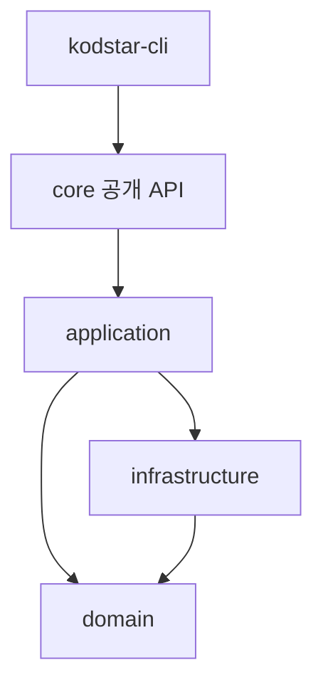
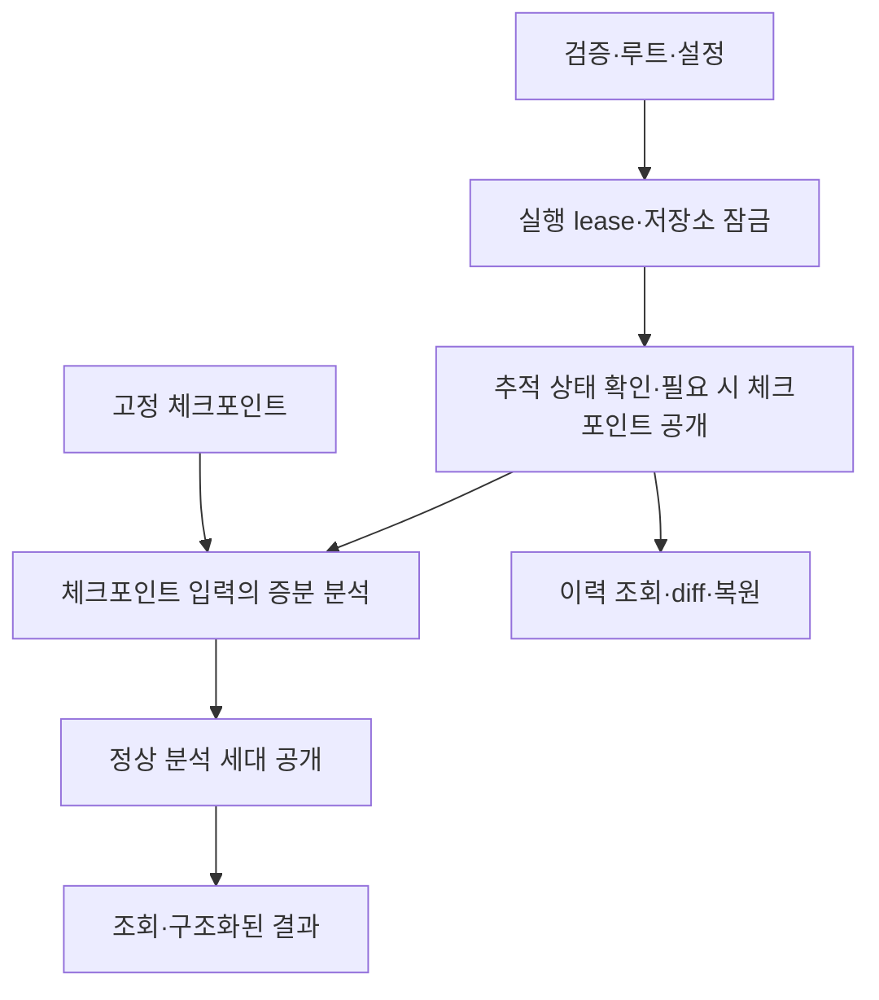

# kod<sup>☆</sup> 코드 아키텍처

이 문서는 현재 코드의 책임·의존 방향·실행과 자원 수명을 설명한다.
명령·출력·추적 범위는 [기능 명세](../kodstar-spec.md), 검증·측정과 최적화 검토는
[개발 문서](development.md), 사용법은 [README](../README.md)에서 관리한다.

## 레이어와 의존 방향



| 구성 | 책임 |
|---|---|
| `domain` | 사실·객체·관계·해석 상태·조회·이력 요청과 구조화된 결과 |
| `application` | 프로젝트 선택, 체크포인트 수집 정책, 분석·해석·조회·유지보수 조정 |
| `infrastructure` | 디스크 순회, 보존 입력, parser, 포맷, SQLite와 잠금 |
| `kodstar-cli` | 인자·stdio 파싱, 엔진 호출, 표시·진행·종료 코드, 설치·터미널 확인 |

공개 진입점은 [lib.rs](../crates/kodstar-core/src/lib.rs)다. CLI와 stdio worker는 같은
`Engine::execute`를 사용하며 엔진 결과는 `QuerySink`로 전달한다. text·JSON·JSONL·TSV는 CLI가 표시한다.
SQL·connection·parser 타입은 core 내부에서 사용한다.

## 소스 구성도

주요 책임을 표시한 구성도다. 언어별 규칙은 해당 레이어 안에서 분리한다.

저장 기능은 다음 경계로 나눈다. `index/dictionary`는 안정된 key ID와
접두어 압축 블록·검색 경로를, `index/relations`는 관계 블록·역방향 경로와 변경을 소유한다.
공통 `index/packed`는 SQLite 검색 조건과 제한된 블록 cursor만 연결한다. 전체 사전이나 관계를
상주시키지 않으며 transaction 안의 변경을 같은 connection에서 읽는다.
`history/content`는 원문 청크·codec·읽기·내용 기반 분할을,
`history/maintenance`는 명시적 형식 전환·기존 내용 재압축·검증을,
`history/checkout`은 복원 journal·파일 공개를 소유한다.
검증 스크립트는 `scripts/checks`, 측정·독립 decoder는 `scripts/benchmarks`,
고정 grammar 생성은 `scripts/grammars`에 둔다.

```text
install.sh                                  # 고정 toolchain 빌드·사용자 설치 진입
crates/kodstar-core/src/
├── lib.rs                                  # 공개 API와 지원 플랫폼
├── domain/
│   ├── facts.rs                            # scope·정의·binding·사용 사실
│   ├── facts/fingerprint.rs                # 사실·lookup 환경 fingerprint
│   ├── symbols.rs                          # 객체와 정의 위치
│   ├── relations.rs                        # 관계·방향·해석 상태
│   ├── query.rs                            # 선택자·탐색 옵션
│   ├── history.rs                          # 이력 요청·결과·이름 규칙
│   └── results.rs                          # 결과·metadata·sink
├── application/
│   ├── engine.rs                           # 공개 엔진 호출
│   ├── workspace/                          # 루트·설정 선택
│   ├── execution/
│   │   ├── mod.rs                          # CommandHandler 실행 순서
│   │   ├── context.rs                      # 동기화와 실행 자원 수명
│   │   ├── prepare.rs                      # 현재·과거 분석 준비
│   │   └── history.rs                      # 분석 독립 이력 명령
│   ├── history/
│   │   ├── capture.rs                      # 추적 상태 수집·체크포인트 공개
│   │   ├── listing.rs                      # 이력·브랜치 순회
│   │   ├── compare.rs                      # 두 저장 상태 비교
│   │   ├── text.rs                         # 제한된 텍스트 차이 표시
│   │   ├── text/                           # 스트리밍 UTF-8 검증·변경 구간·한 행 표시
│   │   ├── branches.rs                     # 브랜치 상태 전이
│   │   ├── impact.rs                       # 변경 전후 분석과 영향 시드
│   │   └── impact/rows.rs                  # 양쪽 결과의 전체 출력·방문 한도
│   ├── analysis/
│   │   ├── mod.rs                          # 정상 분석 재사용·갱신 transaction·세대 공개
│   │   ├── discovery.rs                    # 보존 입력의 변경 판정·작업 전달
│   │   ├── pipeline.rs                     # producer·worker·writer 조정
│   │   ├── workers.rs                      # parser·취소·파일별 추출
│   │   ├── batches.rs                      # 바이트 예산 내 fact 전달
│   │   ├── incremental.rs                  # Rust·Go 본문/선언 범위의 보수적 판정
│   │   ├── configurations.rs               # 참조된 설정 분석
│   │   ├── configuration_input.rs          # 공유 snapshot reader의 설정 사실 추출
│   │   ├── module_identity.rs              # 보존 manifest의 package·module 식별
│   │   └── resolve/                        # 언어별 이름·모듈·타입·관계 해석
│   ├── query/                              # 선택·관계 조회·디스크 탐색
│   ├── cache.rs                            # 명시적 캐시 정책
│   ├── maintenance.rs                      # 자동 GC 정책
│   └── installation.rs                     # 초기화 대상·설치 lease·데이터 제거 API
└── infrastructure/
    ├── scan/mod.rs                         # 이력 수집용 디스크 파일·symlink 순회
    ├── history/
    │   ├── mod.rs                          # 영구 DB·형식·잠금
    │   ├── schema.sql                      # 내용·이력·작업 catalog·복원 journal
    │   ├── content/                        # 원문 내용의 주소·분할·인코딩·읽기
    │   │   ├── blobs.rs                    # 중복 판별·원문 해시·재읽기 검증
    │   │   ├── chunks.rs                   # 공유 주소·물리 표현 선택
    │   │   ├── chunks.sql                  # 공유 내용·blob 참조·논리 view
    │   │   ├── chunking.rs                 # 제한된 내용 기반 경계
    │   │   ├── encoding.rs                 # literal/copy·깊이 1 델타
    │   │   ├── chunk_read.rs               # 주소·크기·개행 검증
    │   │   ├── reader.rs                   # 가변 경계 검색·마지막 청크 보유
    │   │   └── chunk_ranges.rs             # 같은 내용 구간 검색
    │   ├── maintenance/                    # 명시적 전환·재압축·무결성
    │   │   ├── mod.rs                      # 알려진 schema·전환·VACUUM 경계
    │   │   ├── legacy.rs                   # 형식 1·2·3의 스트리밍 변환
    │   │   ├── repack.rs                   # 제한 후보·독립 기준 재선택·rollback
    │   │   └── verification.rs             # 저장 참조·보존 바이트 확인
    │   ├── inputs/                         # 체크포인트 순회·제한된 분석 입력
    │   ├── checkpoints.rs                  # 시점 선택·파일 구성·이름
    │   ├── checkout/                       # 복원 journal·충돌·파일 공개
    │   │   ├── mod.rs                      # 복원 계획·재개·참조 공개
    │   │   ├── checks.rs                   # 충돌·완료 파일·장치 검사
    │   │   ├── files.rs                    # staging·rename·fsync
    │   │   └── tree.rs                     # 파일·디렉터리 전환
    │   └── paths.rs                        # 상대 경로·저장 파일 검증
    ├── languages/                          # 공식 grammar 선택·capability
    ├── parse/                              # AST 순회·언어별 사실 추출·파일 내 재사용·parser 수명
    ├── formats/
    │   ├── auxiliary/                      # manifest·설정·form 입력
    │   └── components/                     # 혼합 코드 영역·원본 위치 대응
    ├── index/                              # 분석 DB·사실·조회 의존·객체 복원·통계
    │   ├── cached.rs                       # 해석 SQL의 제한된 재사용 풀
    │   ├── dictionary/                     # 접두어 사전·정렬 병합·안정 ID·회수·검증
    │   ├── dependencies/                   # 의존성 블록·가변 정수·논리 view·검증
    │   ├── relations/                      # 파일·source 관계 블록·경로·공개·회수·검증
    │   ├── packed/                         # SQLite 조건 전달·한 블록 cursor·정규 정수
    │   ├── inert_inputs.rs                 # 이력 전용 입력 변경 판정
    │   └── invalidation.rs                 # 갱신 전 소비 파일 보존·부분 해석 준비
    ├── cache/                              # cache 등록·lease·catalog·안전한 삭제
    └── installation/                       # 영구 프로젝트 등록부·설치 lease·제거
crates/kodstar-cli/src/
├── args/                                   # 명령 트리
├── invocation/                             # 입력을 엔진 요청으로 변환
├── run.rs                                  # 프로세스·엔진 실행 연결
├── confirmation.rs                         # 최초 경로·제거 확인
├── output/                                 # 형식별 표시·진행
├── session/                                # stdio frame·요청·worker·완료
└── installation/                           # receipt·실행 파일·PATH 등록과 제거
scripts/
├── benchmarks/                             # 분석·이력 측정과 독립 기준 decoder
├── checks/                                 # 소스 규칙·대화형 확인 검사
└── grammars/                               # 고정 Kotlin grammar 생성·출처 검사
```

`parse`의 언어 모듈은 구문 사실을, `analysis/resolve`의 언어 모듈은 이름·모듈·멤버 선택을 담당한다.
공통 AST 순회·parser 수명·사실 예산은 `parse`가 관리한다. 혼합 입력의 masking과 원본 위치 환산은
`formats/components`, 행 기반 보조 입력의 위치 계산은 `formats/auxiliary/lines.rs`가 담당한다.
언어별 세부 배치·포팅 범위는 [포팅 검증](development.md#포팅-검증)을 따른다.

## 저장과 식별

| 상태 | 소유자 | 수명·식별 |
|---|---|---|
| 원본 내용·체크포인트·이름·브랜치 | `infrastructure/history` | 영구 이력; 저장소 ID와 체크포인트 ID |
| 추적·변경 판정·공개 정책 | `application/history/capture` | 완전한 한 번의 관찰과 transaction |
| 현재 파일 구성 | 이력의 `working` catalog | 경로·blob·종류·권한·파일 metadata |
| 과거 파일 구성 | `history/checkpoints` | 변경 목록에서 구성한 디스크 임시 테이블 |
| 복원 계획·완료 표시 | `history/checkout` | 중단 후 대조·복구가 끝날 때까지 유지 |
| 사실·binding·관계·진단·통계 | `infrastructure/index` | 저장소·체크포인트·설정·추출 버전에 연결한 분석 세대 |
| 설치와 프로젝트 등록 | `infrastructure/installation` | 캐시 GC와 독립된 등록부·설치 lease |

작업 파일, 보존된 체크포인트, 분석 세대는 서로 다른 상태다. 내부 fact fingerprint는 영구 이력의
직렬화나 객체 ID로 사용하지 않는다. 현재 분석은 `index.sqlite`, 과거 분석은 한 개의 `past.sqlite`를 재사용한다.
저장소 identity와 분석 환경을 검증한 뒤 캐시를 사용한다. 브랜치마다 소스나 분석 DB 전체를 복제하지 않는다.

영구 이력 형식 4는 원문 청크를 BLAKE3 주소로 공유하고 제한된 literal/copy 표현을 일반 rowid 테이블에 둔다.
작은 blob별 순서·시작 offset·정수 청크 참조는 복합 키로 보존한다. 기존 형식 1·2·3은 자동 변환하지 않는다. `history upgrade`만 저장소 잠금·transaction 아래 기존 내용의
크기·해시를 검증하며 형식을 전환한다. 체크포인트·blob ID·브랜치·복원 journal은 보존하고 실패·취소는
전체 rollback한다. 사용 중인 원본 이력을 삭제하거나 새 저장소로 대체하지 않는다.
이전 형식에 알 수 없는 schema 객체나 chunk 열이 있으면 변경 전에 전환을 거절한다.
전환 후의 명시적 VACUUM은 빈 페이지를 회수하는 별도 단계이며 실패해도 완료된 형식은 유지한다.
`history upgrade`는 작업 파일을 복원하지 않으며 pending checkout journal은 다음 일반 실행에 넘긴다.

분석 형식 12는 조회 사전을 최대 32개 key·64KiB 복원 문자열 블록으로 접두어 압축한다.
각 블록 첫 key가 재시작점이며 `(kind, first)` 희소 인덱스와 정수 ID 경로가 정확 검색을 지원한다.
단일 큰 key는 경계 문자열을 중복 저장하지 않는 독립 블록으로 보존한다. 제한된 해시 검색 경로를 거친 뒤 원래 key로 정확히 비교하므로 해시만으로 대상을 합치지 않는다. key 전체를 반복 저장하는 고유 인덱스는
두지 않는다. 정렬 병합은 변경된 블록만 쓰고 기존 ID를 유지한다. 성공·실패 의존성의 마지막 소비자가
없어지면 같은 세대 transaction에서 key를 회수한다. 연결 소유의 TEMP trigger가 삭제된 의존성 key만 회수 후보로 기록하며, 작은 갱신에서 사전 전체를 재검사하지 않는다.

`lookup_blocks`는 파일별 fact ID 차이와 성공 bit를 최대 128개씩 저장한다. 관계는 파일·source별
최대 128행과 64KiB 바이트 목표로 묶는다. 단일 큰 외부 key는 값 한도 안에서 별도로 보존한다.
ID 차이·fact의 부호 있는 차이·nullable 정수·해석 상태를 인코딩하며 source를 블록마다 한 번 저장한다.
source 인덱스와 target·fact·설명 텍스트의 블록 경로가 조회·cascade·GC를 지원한다.
`packed`의 virtual table은 실제 조건을 해당 경로로 전달하고 cursor마다 한 블록만 복원한다.
원문·위치·관계 방향·개별 사용·후보·미해결은 논리 `relationships`와 lookup view에서 유지한다.
일반 SQLite 도구로 논리 행을 읽으려면 등록된 adapter가 필요하며 비교 스크립트는 독립 decoder를 쓴다.

ID 경로·payload·해석·진단·세대는 한 transaction에서 공개한다. doctor는 압축 내용뿐 아니라
희소 범위·ID 경로·역방향 경로·fact 소유 파일도 대조한다. 이전 분석 캐시는 명시적 cache 정리 뒤
재생성하며 영구 이력의 변환·삭제와 연결하지 않는다.

`history upgrade`는 형식 전환이 필요 없는 형식 4에서도 기존 청크 표현을 재검토한다. 같은 경로와
비슷한 크기의 앞선 독립 청크를 최대 8개 비교한다. 한 번에 현재 원문·기준·후보 표현만 보유하며
후보 catalog와 원래 경로는 디스크 임시 테이블에 둔다. 공간 이득이 있을 때만 바꾸며 기준 ID가
대상보다 작고 기준 자체는 독립이라는 깊이 1 규칙을 유지한다. 이미 기준인 청크를 델타로 바꾸지 않는다.
재압축 전후 원문을 검증하고 실패·취소는 재압축 transaction 전체를 rollback한다. checkpoint·blob·청크
ID와 참조·이름·계보·복원 journal은 보존한다. 모르는 schema 객체는 재압축 전에 거절한다.
VACUUM은 commit 뒤 별도 단계여서 실패해도 검증된 재압축 결과는 유효하다.

| SQLite 작업 | 소유 모듈 |
|---|---|
| 이력·chunk·파일 구성·복원 journal | `infrastructure/history` |
| 분석 connection·schema·저장 버전·파일·사실 저장 | `infrastructure/index` |
| 분석 transaction·세대 공개 | `application/analysis` |
| 이름 해석 SQL·후보·조회 의존·관계 | `application/analysis/resolve` |
| 객체 선택·관계 SQL·탐색 | `application/query` |
| 등록부와 소유권 확인 후 제거 | `infrastructure/installation` |

## 공통 실행과 분석

`CommandHandler`가 검증·준비 정책·진행 callback·실행을 정의한다. 라이브러리의 편의 메서드도
같은 실행기를 사용한다. 최신성 정책은 [공통 증분 동기화](../kodstar-spec.md#111-명령의-공통-증분-동기화)를 따른다.



디스크 순회는 체크포인트 수집만 담당한다. discovery·명시 설정 분석은 보존 입력만 받으며
직접 파일 읽기로 대체하지 않는다. 원본과 parser 입력이 같은 바이트에 속하도록 blob의 크기·해시를
검증한다. 검증한 버퍼를 다시 해시하지 않고 보존된 내용 해시를 사용한다.
패키지 경계의 manifest 존재 여부도 같은 체크포인트에서 확인한다.

수집은 임시 `observed` 목록과 `working`을 대조한다. 경로 인덱스가 역방향 존재 검사를 지원하며
변경 없는 catalog 행은 다시 쓰지 않는다. 전체 목록·원문·AST를 한꺼번에 메모리에 모으지 않는다.
내용은 고정 버퍼로 먼저 해시하고 이미 보존한 blob이면 chunk를 쓰지 않는다. 새 내용만 같은 입력을
되감아 저장하며 두 번 읽은 크기·해시가 다르면 수집 transaction을 취소한다. diff와 영향 분석의
임시 파일 목록에도 경로 인덱스를 유지해 양방향 대조의 반복 전체 스캔을 피한다.

수집 이후 repository·checkpoint·설정·추출·관계 버전이 정상 완료된 분석과 같으면 저장된 coverage와
세대를 재사용한다. 이 경로는 discovery·worker·분석 transaction을 열지 않는다. 소스 변경 확인은
항상 먼저 수행하며 명시적 verify·full과 이전 실패·취소 상태는 일반 분석 경로로 처리한다.

분석은 writer lock 아래 transaction을 열고 다음 순서로 처리한다.

1. discovery가 체크포인트 파일을 순회하고 metadata·해시·설정으로 재사용 여부를 결정한다.
2. 제한된 worker가 소스 하나에서 사실을 추출하고 바이트 예산 내 배치를 writer에 전달한다.
3. 완전한 입력 목록의 삭제와 설정·프로젝트 소속을 반영한다.
4. 변경한 사실·lookup 환경에 따라 해석하고 정의·binding·관계·진단·통계·세대를 함께 공개한다.

lexical binding·import/export·receiver 근거로 대상을 선택하며 상속·구현 관계를 먼저 처리한다.
구문 정의와 대표 객체를 분리해 선언 위치를 보존한다. 후보·lookup 의존·관계 staging은 같은 분석
transaction에서 수행한다. 실패·취소는 rollback하며 마지막 정상 분석을 보존한다.

추출 사실이 같으면 기존 관계를 유지한다. 검증된 Rust 단순 본문과 환경이 같은 Go 본문은
symbol ID를 유지하고 변경 파일 참조를 재해석한다. Go package 함수 선언의 추가·삭제·rename은
성공·실패 lookup의 소비 파일까지 넓혀 재해석한다. 타입·설정·지원하지 않는 경계는 전체 해석한다.

체크포인트와 분석 transaction은 별개다. 이력을 먼저 보존하며 분석 실패로 완성된 소스를 삭제하지 않는다.
이력 전용 작업은 parser·분석 DB를 필수로 열지 않는다. 진단은 소스와 마지막 정상 분석의 불일치를 보고한다.

설정 분석은 명령 안의 snapshot connection과 준비한 조회를 공유한다. parser의 AST 재사용은 파일
범위이며, 한 AST로 끝난 예비 추출의 트리를 다음 순회로 넘긴다. 여러 AST가 필요한 입력은 이전
트리를 해제한 뒤 다음 트리를 생성해 동시 보유량을 늘리지 않는다. 완료·오류에서 재사용 상태를 비운다.
텍스트 diff는 청크 reader로 양쪽 내용의 UTF-8·무결성을 먼저 검증하고 고정 버퍼로 공통 구간을
계산한다. 검증한 청크 주소와 줄 수·처음/마지막 개행 위치로 같은 구간의 재읽기를 건너뛴다.
줄 metadata도 내용과 대조하며 표시할 행 하나만 소유해 원본 행 번호·UTF-8·긴 행을 보존한다.
전체 검증을 마친 내용은 같은 저장소 잠금 범위 안의 구간 읽기에서 해시를 다시 계산하지 않는다.

## 자원과 잠금 수명

| 자원 | 소유자·해제 시점 |
|---|---|
| cache 경로 | `Engine`; 호출 사이에는 경로만 보관 |
| 설치 lease·이력·분석 connection | `execution::Context`; 결과 처리 후 해제 |
| 이력 cursor·snapshot reader | 수집·입력 순회 범위; 순회 완료 후 해제 |
| parser·소스·AST | 제한된 worker; 파일 종료 후 소스·AST 해제 |
| 입력 permit·fact 배치·큐 | producer·worker·writer; 소비한 바이트와 함께 해제 |
| SQLite statement·정렬·frontier·visited | 해석·조회 범위; 제한된 page cache와 디스크 임시 저장 사용 |
| 객체 반복 재사용 | 조회 `SymbolReader`; 개수·바이트 한도 유지 |
| stdio worker·취소 토큰 | session; EOF·shutdown·취소 후 종료 확인 |

DB·입력·fact·큐의 예산은 `Settings`와 history의 cache 상수가 소유한다. 설정 예산은 OS의 hard RSS
한도가 아니며 AST와 네이티브 allocator의 실제 사용은 측정해야 한다. blob 읽기는 선언된 크기와
요청 한도를 검사하고, 그 크기를 초과하는 chunk를 출력 버퍼에 전달하기 전에 거절한다.

producer·worker는 scoped thread로 join한다. 수신기 guard는 오류·panic에서 취소를 전파하고
수신기를 닫아 sender를 해제한다. 결과는 행 단위로 sink에 전달한다.

잠금은 설치 lease → 이력 저장소 → cache lease·writer 순서로 획득한다. watch는 유휴 중에도
설치·cache lease를 유지하고 이력 잠금은 동기화 구간에만 유지한다. 자체 저장소·캐시 이벤트는
제외하고 overflow에 의한 재스캔은 보존한다. cache catalog·삭제는 registry lock과 lease를 공유한다.

## 복원과 설치 수명

복원·전환은 사전 보존 → 대상·충돌 검사 → journal commit → 파일 반영 → 참조 확정 순서다.
staging 파일과 디렉터리를 sync하고 rename한다. 재개 시 완료 표시 파일도 대조하며 외부 편집
충돌은 추가 쓰기 전에 중단한다. 다중 파일 변경을 하나의 원자 작업으로 취급하지 않는다.
추적·속성·파일시스템 제한은 [보존 계약](../kodstar-spec.md#154-추적-범위와-제한)을 따른다.

프로젝트 등록부는 캐시 GC와 별개다. 일반 실행·stdio 세션은 shared 설치 lease를,
제거는 exclusive lease를 보유한다. 제거는 모든 등록 경로·identity·잠금·알려진 파일을 먼저 검사하며
checkout 복구를 실행하지 않는다. 캐시 삭제를 마친 후 정리용 registry lock을 제거한다.

CLI receipt가 실행 파일과 shell PATH 블록의 소유권을 기록한다. shell의 다른 내용과 심볼릭 링크를
보존하며 수정된 실행 파일·관리 블록·알 수 없는 파일을 발견하면 진단한다. 설치·제거의 대상과
사용자 확인은 [설치 계약](../kodstar-spec.md#설치최초-실행제거)을 따른다.

## 실프로젝트 비용 축소 구현과 후속 설계

공통 SQL·저장 경로와 검증한 증분 조건을 구현했다. 측정 조건과 결과는
[개발 문서](development.md#공통-비용-축소-구현)에 둔다. 초기 Go 측정의 시간과 절감률을 다른 언어에 적용하지 않는다.

### 공통 변경 계획

`incremental`이 `None / ChangedFiles / All`을 판정한다. `ChangedFiles`는 실제 추출 파일과
조회 의존성의 소비 파일을 합친 **재해석 파일 집합**이며, 파일 안의 모든 구문 사실을 다시 해석한다.
새로운 범용 실행 프레임워크나 전역 cache는 두지 않는다.

| 입력·변경 | 현재 동작 |
|---|---|
| 기존 unsupported/skipped 입력 수정·삭제 | 이전 의미 행과 명시적 파일 lookup 소비자가 없으면 이력·metadata·진단만 갱신 |
| 사실과 위치가 같은 추출 | 파일 metadata와 root range 갱신, 관계 재사용 |
| Rust 단순 본문 | 기존 보수적 조건과 같은 환경에서 정의 ID를 유지하고 변경 파일 재해석 |
| Go 본문 | 파일의 정의·scope·binding 환경이 같으면 ID 유지. 혼합 언어 프로젝트에서도 이 조건을 사용 |
| Go package 함수 선언 추가·삭제·rename | Go 사실만 있는 프로젝트에서 이전·새 파일이 package 함수만 제공하면 lookup·대상 참조의 소비 파일 재해석 |
| 타입·method set·설정·확인하지 못한 경계 | 전체 해석. 부분 갱신으로 분석 범위나 후보를 줄이지 않음 |

이력 수집은 모든 경로에서 먼저 수행한다. 이력 전용 변경도 체크포인트와 coverage·진단·분석 연결을
갱신한다. `unsupported`라는 표지만으로 분석 영향이 없다고 판단하지 않으며, 입력 분류 전이·설정
소비·파일 존재 lookup과 이전 구문 행을 확인한다.

### 의존성과 원자적 공개

선언을 삭제하기 전에 `index/invalidation.rs`가 대상 참조와 성공·실패 lookup의 소비 파일을
TEMP `dependent_files`에 보존한다. 같은 package 이름 조회는 정확한 package/module prefix로,
명시적 Go module 조회는 workspace·replace 매핑의 누락을 피하도록 Go 소비 파일 전체를 보수적으로
선택한다. 이 범위를 임의의 이름 유사도나 디렉터리 경계만으로 줄이지 않는다.

새 파일의 실제 정의를 저장한 뒤 package 함수 조건을 다시 확인한다. 타입·method·타입 이름 충돌 등
부분 갱신 조건이 깨지면 전체 해석으로 넓힌다. 외래 키 cascade 이후에 이전 참조를 복원하려 하지 않는다.
설정 변경과 다른 언어의 의미 사실이 있는 선언 변경도 전체 해석으로 처리한다.

부분 해석은 선택한 파일의 이전 구문 관계·lookup과 호출 dispatch를 교체한다. 환경이 같은 Go의
method set 구현 후보는 보존하고 정의 위치를 갱신하며, 변경 호출의 interface dispatch를 다시 만든다.
새 Go 정의의 대표 ID도 같은 transaction에서 연결한다. 완료·실패·취소는 정의·사실·관계·의존성·진단·
coverage·세대를 함께 commit 또는 rollback한다.

### SQL과 저장 자원

`index/cached.rs`의 `Sql`이 실제 연결을 빌리고, 해석 작업 동안 고정 SQL과 statement를 재사용한다.
빌려준 statement는 풀에서 빠지므로 재귀 lookup이 활성 cursor를 재사용하지 않는다. 반환할 때
parameter를 지우고 SQLite `MemUsed`와 SQL key 보유량을 대조한다. 유휴 statement는 최대 64개, 읽기 예산의 1/4·최대 1MiB로 제한한다.
활성 작업의 보유량은 읽기 예산으로 대조하며 유휴 자원을 먼저 회수한다. 쓰기 연결의 page cache는
설정 예산의 1/4을 사용해 SQL 재사용·블록 인코딩 자원과 함께 보유량을 낮춘다. 파일 저장·정리도 pipeline 소유의 같은 제한 풀에서 SQL을 재사용한다. 작업이 끝나면 풀과 statement를 해제한다.
기존 `Prepared`의 고정 binding·publication 문장도 별도의 명시적 예산과 같은 작업 수명을 유지한다.

후보·owner TEMP 집합에서 시작하는 멤버 조회는 기본 키와 기존 인덱스로 대상 행을 읽는다.
`CROSS JOIN`과 상관 `EXISTS`로 작은 작업 집합보다 전체 symbols가 먼저 반복 스캔되는 계획을 피한다.
명시적으로 소유한 집합 경계를 유지하는 선택이며, 근거 없는 전역 join 순서 강제나 인덱스 추가가 아니다.
[SQLite의 join 순서 제어](https://www.sqlite.org/optoverview.html#manual_control_of_query_plans_using_cross_join)를
참고하고 결과 집합·후보·사용 위치와 전체 분석 동등성을 검증한다.

lookup key 공유는 SQLite가 소유한다. 성공 여부가 false인 행도 남기며, publication은 임시 의존성의
논리 행을 정수 ID로 연결한다. 해석 중 Python 규칙이 임시 lookup 기록을 읽는 순서는 유지한다.
미참조 key는 같은 쓰기 transaction의 완료 단계에서 정리한다. 매 조회에 전체 cache를 정리하지 않는다.

### 배포와 보존 형식

형식 3에서 적용한 BLOB의 rowid 배치를 유지하며, 현재 형식 4의 표현은 다음 절에서 설명한다.
작은 `chunk_refs`는 `WITHOUT ROWID`를 유지한다. `history upgrade`가 형식 1·2·3을
명시적으로 검증·전환하며, 알 수 없는 데이터·취소·저장 공간 부족은 원형을 보호한다.
전환 후 VACUUM은 별도 단계다. 새 형식이 commit된 뒤 정리만 실패하면 같은 명령으로 재시도한다.
이력 형식 인식은 history가 소유하며 uninstall도 같은 지원 버전 판정을 사용한다.

개발·profile용 release는 심볼을 유지한다. 설치기는 `dist` profile의 심볼 제거 실행 파일을 복사한다.
언어 grammar·지원 범위·panic 정리 경로는 동일하다. `target/`의 native 중간 파일은 설치하지 않으며,
반복 개발용 cache를 매번 제거해 빌드 시간을 늘리지 않는다.

### 저장 표현 최적화

분석 저장 형식 11은 lookup 의존성을 `index/dependencies`가 소유한다. `(key_id,file_id,part)`별
최대 128개의 정렬된 fact ID와 found bit를 차이·가변 길이 정수로 묶는다. publication이 디스크의
정렬된 임시 행을 제한된 블록으로 쓰고 파일 갱신은 해당 파일 블록만 교체한다. 역조회는 key 기본 키에서
시작한다. 논리 view의 확장은 연결에 등록한 무부작용 함수가 한 블록씩 수행하며 전체 집합을 적재하지 않는다.
잘못된 정수·중복·순서·블록 크기는 오류다. 성공·실패 의존성과 사용 위치는 유지한다.

영구 이력 형식 4는 history가 내용 주소·물리 표현·복원을 소유한다. 최대 64KiB 파일의 변경은 같은
파일의 이전 독립 청크와 제한된 델타로 비교하고, 큰 파일은 Gear hash로 경계를 정한 청크를 공유한다.
`chunking.rs`는 최소 2KiB·목표 8KiB·최대 32KiB 경계를 입력 read 크기와 독립적으로 선택한다.
`encoding.rs`는 8,192 slot·단일 후보 hash 표에서 같은 원문 구간을 찾고 literal/copy로 저장한다.
독립 인코딩과 기준 청크를 쓰는 인코딩을 비교하며, payload 외 최소 32바이트 이득이 없으면 더 단순한
표현을 유지한다. 범용 코덱·새 의존성·사전 학습·전체 파일 후보 탐색은 추가하지 않았다.
내용 주소는 복원한 원문으로 계산하며 저장 표현과 독립이다. 델타의 base·깊이·누적 복원 바이트와
청크의 최대 크기를 제한한다. 기준은 raw 또는 독립 인코딩만 허용해 깊이는 1, 기준과 대상 원문은
각각 최대 64KiB다. `chunk_read.rs`는 주소·크기·개행을 검증하고 `reader.rs`는 시작 offset을 검색해
reader당 마지막 복원 청크 하나만 보유한다. 체크포인트 파일 목록은
기존 변경분 저장을 유지한다. 원문·복원·분석 의미를 줄이는 최적화는 포함하지 않는다.

기존 이력은 `history upgrade`의 단일 transaction에서 검증·전환한다. 이전 ID·branch·이름·복원
journal과 바이트를 보존하고 취소·손상·공간 부족은 rollback한다. 분석 cache는 명시적으로 정리 후
다시 만든다. 표현별 실제 디스크·조회·갱신·복원 시간과 RSS를 비교하고 검증한 구현 상태는 개발 문서에 기록한다.
전환은 기존 원문 청크 경계를 유지해 독립 인코딩하며 정상 미참조 내용 주소도 보존한다. 내용 기반
재분할과 이전 파일을 기준으로 한 델타 선택은 새 blob 수집에 적용한다. 과거 전체 이력의 재분할·기준
재선정은 수행하지 않는다.

### 후속 범위

다른 언어의 부분 갱신은 각 소유자가 무효화 근거와 전체 분석 동등성을 제공한 뒤 확장한다.
Python import·MRO, JS/TS workspace·재수출·alias, C/C++ include·선언 정체성, Rust trait·macro,
혼합 포맷의 script/template·위치 mapping을 공통 정책에 추정으로 합치지 않는다.

반복 rule/reason의 저장 정수화는 구현했다. Go module 소비 파일의 더 좁은 역조회, 파일 안의 영향
fact만 선택하는 세분화와 정렬된 긴 관계 목록의 별도 압축은 후속 측정 대상으로 둔다. 기본적인 전체 해석 fallback은 유지한다.

내용 기반 청크와 제한 literal/copy 표현의 장기 수정 검증은 개발 문서에 둔다. 추가 범용 코덱과
의존성에는 기존 라이선스·유지보수·3,000 stars 기준을 적용한다.
자동 이력 삭제나 보존 범위 축소는 포함하지 않는다. 언어 선택 빌드는 필요 시 별도 제품 구성으로
검토하며, 지원 grammar를 줄인 결과를 동일 기능의 용량 개선으로 보고하지 않는다.
