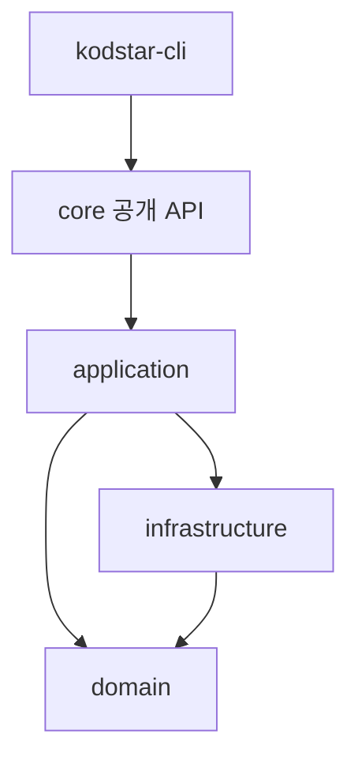
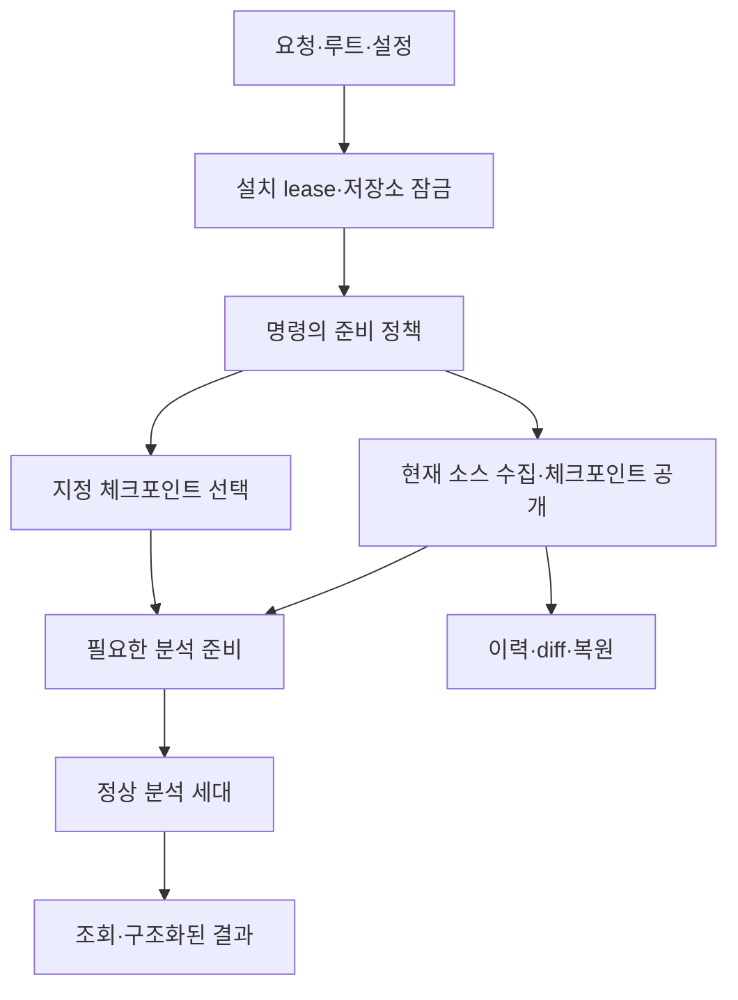

# kod<sup>☆</sup> 코드 아키텍처

이 문서는 현재 코드의 책임·의존 방향·실행과 자원 수명을 설명한다.
명령·출력·추적 범위는 [기능 명세](../kodstar-spec.md), 빌드·검증 절차는
[개발 문서](development.md), 사용법은 [README](../README.md)에서 관리한다.

## 레이어와 의존 방향



| 구성 | 책임 |
|---|---|
| `domain` | 사실·객체·관계·해석 상태·조회·이력 요청과 구조화된 결과 |
| `application` | 프로젝트 선택, 체크포인트 수집 정책, 분석·해석·조회·유지보수 조정 |
| `infrastructure` | 디스크 순회, 보존 입력, parser, 포맷, SQLite와 잠금 |
| `kodstar-cli` | 인자·stdio 파싱, 엔진 호출, 표시·진행·종료 코드, 설치·터미널 확인 |

공개 진입점은 [lib.rs](../crates/kodstar-core/src/lib.rs)다. CLI와 stdio worker는 같은
`Engine::execute`를 사용하며 엔진 결과는 `QuerySink`로 전달한다. text·JSON·JSONL·TSV는 CLI가 표시한다.
SQL·connection·parser 타입은 core 내부에서 사용한다.

## 소스 구성도

주요 책임을 표시한 구성도다. 언어별 규칙은 해당 레이어 안에서 분리한다.

저장 기능은 다음 경계로 나눈다. `index/dictionary`는 안정된 key ID와
접두어 압축 블록·검색 경로를, `index/atoms`는 공유 문자열과 참조 수명을, `index/records`는
정수 행·바이너리 식별자와 논리 열을, `index/relations`는 관계 블록·역방향 경로와 변경을 소유한다.
공통 `index/packed`는 SQLite 검색 조건과 제한된 블록 cursor만 연결한다. 전체 사전이나 관계를
상주시키지 않으며 transaction 안의 변경을 같은 connection에서 읽는다.
`history/content`는 원문 청크·codec·읽기·내용 기반 분할을,
`history/maintenance`는 명시적 형식 전환·기존 내용 재압축·검증을,
`history/checkout`은 복원 journal·파일 공개를 소유한다.
검증 스크립트는 `scripts/checks`, 측정·독립 decoder는 `scripts/benchmarks`,
고정 grammar 생성은 `scripts/grammars`에 둔다.

```text
install.sh                                  # 임시 CLI 빌드·종료 시 정리·사용자 설치 진입
crates/kodstar-core/src/
├── lib.rs                                  # 공개 API와 지원 플랫폼
├── domain/
│   ├── facts.rs                            # scope·정의·binding·사용 사실
│   ├── facts/fingerprint.rs                # 사실·lookup 환경 fingerprint
│   ├── symbols.rs                          # 객체와 정의 위치
│   ├── relations.rs                        # 관계·방향·해석 상태
│   ├── resolve/lookup_keys.rs               # 실제 Go provider package 의존성 key
│   ├── query.rs                            # 선택자·탐색 옵션
│   ├── history.rs                          # 이력 요청·결과·이름 규칙
│   └── results.rs                          # 결과·metadata·sink
├── application/
│   ├── engine.rs                           # 공개 엔진 호출
│   ├── workspace/                          # 루트·설정 선택
│   ├── execution/
│   │   ├── mod.rs                          # CommandHandler 실행 순서
│   │   ├── context.rs                      # 동기화와 실행 자원 수명
│   │   ├── state.rs                        # 최초·진단 의도와 현재·watch·revision 상태
│   │   ├── prepare.rs                      # 현재·과거 분석 준비
│   │   └── history.rs                      # 분석 독립 이력 명령
│   ├── history/
│   │   ├── capture.rs                      # 추적 상태 수집·체크포인트 공개
│   │   ├── capture/catalog.rs              # 수집 수명의 이전 상태·관찰 행 SQL
│   │   ├── listing.rs                      # 이력·브랜치 순회
│   │   ├── compare.rs                      # 두 저장 상태 비교
│   │   ├── text.rs                         # 제한된 텍스트 차이 표시
│   │   ├── text/                           # 스트리밍 UTF-8 검증·변경 구간·한 행 표시
│   │   ├── branches.rs                     # 브랜치 상태 전이
│   │   ├── impact.rs                       # 변경 전후 분석과 영향 시드
│   │   └── impact/rows.rs                  # 양쪽 결과의 전체 출력·방문 한도
│   ├── analysis/
│   │   ├── mod.rs                          # 정상 분석 재사용·갱신 transaction·세대 공개
│   │   ├── discovery.rs                    # 보존 입력의 변경 판정·작업 전달
│   │   ├── pipeline.rs                     # producer·worker·writer 조정
│   │   ├── workers.rs                      # parser·취소·파일별 추출
│   │   ├── batches.rs                      # 바이트 예산 내 fact 전달
│   │   ├── replay.rs                       # 작은 변경 파일의 제한된 사실 재사용
│   │   ├── incremental.rs                  # 필요 시 한 번 읽는 환경과 재사용 조건
│   │   ├── incremental/body_environment.rs # 본문 변경의 전역 파생 상태 안전 조건
│   │   ├── configurations.rs               # 참조된 설정 분석
│   │   ├── configuration_input.rs          # 공유 snapshot reader의 설정 사실 추출
│   │   ├── module_identity.rs              # 보존 manifest의 package·module 식별
│   │   └── resolve/                        # 언어별 이름·모듈·타입·관계 해석
│   │       ├── fact_batch.rs               # cursor 종료 후 해석하는 제한된 사실 배치
│   │       ├── preparation.rs              # 존재하는 언어·owner hint의 준비 단계 선택
│   │       └── modules/candidates.sql      # export 후보의 이름·가시성·소유 범위 선택
│   ├── query/                              # 선택·관계 조회·디스크 탐색
│   ├── cache.rs                            # 명시적 캐시 정책
│   ├── maintenance.rs                      # 자동 GC 정책
│   └── installation.rs                     # 초기화 대상·설치 lease·데이터 제거 API
└── infrastructure/
    ├── scan/mod.rs                         # 이력 수집용 디스크 파일·symlink 순회
    ├── scan/policy.rs                      # 순회·감시의 기본 제외와 명시 패턴
    ├── history/
    │   ├── mod.rs                          # 영구 DB·형식·잠금
    │   ├── schema.sql                      # 내용·이력·작업 catalog·복원 journal
    │   ├── content/                        # 원문 내용의 주소·분할·인코딩·읽기
    │   │   ├── blobs.rs                    # 중복 판별·원문 해시·재읽기 검증
    │   │   ├── chunks.rs                   # 공유 주소·물리 표현 선택
    │   │   ├── chunks.sql                  # 공유 내용·blob 참조·논리 view
    │   │   ├── chunking.rs                 # 제한된 내용 기반 경계
    │   │   ├── encoding.rs                 # 제한된 Zstd level 1·깊이 1 dictionary 델타
    │   │   ├── chunk_read.rs               # 주소·크기·개행 검증
    │   │   ├── reader.rs                   # 가변 경계 검색·마지막 청크 보유
    │   │   └── chunk_ranges.rs             # 같은 내용 구간 검색
    │   ├── maintenance/                    # 명시적 전환·재압축·무결성
    │   │   ├── mod.rs                      # 알려진 schema·전환·VACUUM 경계
    │   │   ├── legacy.rs                   # 형식 1·2·3의 스트리밍 변환
    │   │   ├── compressed.rs               # 형식 4 원문·주소를 보존하는 Zstd 전환
    │   │   ├── metadata/                   # 경로·해시·이전 상태의 명시적 형식 전환
    │   │   ├── prior_encoding.rs           # 명시적 전환에서만 사용하는 형식 4 decoder
    │   │   ├── repack.rs                   # 제한 후보·독립 기준 재선택·rollback
    │   │   └── verification.rs             # 저장 참조·보존 바이트 확인
    │   ├── inputs/                         # 체크포인트 순회·제한된 분석 입력
    │   ├── checkpoints.rs                  # 시점 선택·파일 구성·이름
    │   ├── checkpoints/materialize.rs      # 가까운 시점 양방향 적용·먼 시점 재구성
    │   ├── metadata.sql                    # 공유 경로·정수 속성·이전 파일 상태
    │   ├── checkout/                       # 복원 journal·충돌·파일 공개
    │   │   ├── mod.rs                      # 복원 계획·재개·참조 공개
    │   │   ├── checks.rs                   # 충돌·완료 파일·장치 검사
    │   │   ├── files.rs                    # staging·rename·fsync
    │   │   └── tree.rs                     # 파일·디렉터리 전환
    │   └── paths.rs                        # 상대 경로·저장 파일 검증
    ├── languages/                          # 공식 grammar 선택·capability
    ├── parse/                              # AST 순회·언어별 사실 추출·파일 내 재사용·parser 수명
    ├── formats/
    │   ├── auxiliary/                      # manifest·설정·form 입력
    │   └── components/                     # 혼합 코드 영역·원본 위치 대응
    ├── index/                              # 분석 DB·사실·조회 의존·객체 복원·통계
    │   ├── cached.rs                       # 해석 SQL의 제한된 재사용 풀
    │   ├── atoms/                          # 공유 문자열·정확한 참조 계수·제한된 writer cache
    │   ├── records/                        # 네 분석 행의 정수 schema·논리 view·쓰기 제약
    │   ├── dictionary/                     # 접두어 사전·정렬 병합·안정 ID·회수·검증
    │   │   └── routing/                    # 128개 ID의 run-length 페이지·범위 참조 보호
    │   ├── dependencies/                   # 의존성 블록·선택 fact 교체·논리 view·검증
    │   ├── relations/                      # 관계 행·검증·선택 복원·블록 갱신
    │   │   ├── prior.rs                    # 동일한 부분 해석 결과의 ID 재사용·예약
    │   │   ├── addresses.rs                # 연속 관계 ID 구간의 검색·차이 공개
    │   │   └── merge.rs                    # 기존 source 블록의 빈 자리 병합
    │   ├── packed/                         # SQLite 조건 전달·빌린 값·한 블록 cursor
    │   ├── inert_inputs.rs                 # 이력 전용 입력 변경 판정
    │   ├── statistics.rs                   # 의미 변경 범위에 따른 통계 공개
    │   ├── statistics/delta.rs             # 제한된 fact 집합의 이전·이후 통계 차이
    │   ├── display_path.rs                 # 원래 경로 바이트에서 표시 문자열 계산
    │   └── invalidation.rs                 # 갱신 전 소비 fact 보존·부분 해석 준비
    ├── cache/                              # cache 등록·lease·catalog·안전한 삭제
    └── installation/                       # 영구 프로젝트 등록부·설치 lease·제거
crates/kodstar-cli/src/
├── args/                                   # 명령·인자와 짧은/상세 도움말
│   ├── options.rs                          # 공통 옵션·기본값 안내·입력 파싱
│   ├── queries.rs                          # 조회 명령·탐색 정책 안내·예시
│   ├── history.rs                          # 이력·브랜치 명령·부수 효과 안내·예시
│   └── tests.rs                            # 공개 도움말 누락·예시 인자 검증
├── invocation/                             # 입력을 엔진 요청으로 변환
├── run.rs                                  # 프로세스·엔진 실행 연결
├── confirmation.rs                         # 최초 경로·제거 확인
├── output/                                 # 형식별 표시·진행
├── session/                                # stdio 요청 수용·worker·결과 전송
│   ├── output.rs                           # 결과·제어 프레임의 제한된 queue·permit
│   ├── frame.rs                            # 64KiB 메모리·큰 프레임 spool·RAII 회수
│   └── transport.rs                        # 취소 가능한 단일 stdout writer·fd 복원
└── installation/                           # receipt·실행 파일·PATH 등록과 제거
scripts/
├── benchmarks/                             # 분석·이력 측정과 독립 기준 decoder
├── checks/                                 # 소스 규칙·대화형 확인 검사
└── grammars/                               # 고정 Kotlin grammar 생성·출처 검사
```

CLI 도움말은 `args.rs`와 `args`의 소유 명령에 정의한다. `-h`는 요약, `--help`는 상세 동작·
제약·예시를 표시한다. 공통 옵션은 엔진의 공개 기본값과 관계 목록을 사용하며 설정 파일을 읽지 않는다.
도움말·버전 파싱은 `Invocation`과 엔진 생성 전에 끝나므로 프로젝트 초기화·동기화를 실행하지 않는다.

검색은 언어별 이름 규칙을 적용하기 전에 정수 이름 ID로 후보를 제한한다. 대표 객체 대응이
없는 snapshot은 중복 제거 window를 생략하고, SQL 결과 한도는 잘림 판정에 필요한 한 행을
포함한다. 관계 탐색은 작업이 소유하는 기존 제한 SQL 풀에서 statement를 재사용하며 허용 관계를 다시 연결하지
않고 방문 순서·경로 선택·한도를 보존한다. SQLite 내부의 반복 JSON 처리는 내장 JSONB를
사용하고 외부 결과는 기존 JSON 계약을 따른다. 큰 stdio 프레임은 고정 크기 파일 버퍼를 거쳐
익명 spool에 기록하고 전송 전에 flush·rewind한다.

`parse`의 언어 모듈은 구문 사실을, `analysis/resolve`의 언어 모듈은 이름·모듈·멤버 선택을 담당한다.
반복 모듈 조회는 공유 문자열의 정수 ID로 언어·package·module 후보를 먼저 제한한다.
Rust export 이름도 정규화한 이름 ID로 좁힌 뒤 기존 namespace·가시성·소유 범위 조건을 적용한다.
추가 영구 인덱스나 전체 후보를 보유하는 메모리 cache 없이 기존 검색 경로를 사용한다.
공통 AST 순회·parser 수명·사실 예산은 `parse`가 관리한다. 혼합 입력의 masking과 원본 위치 환산은
`formats/components`, 행 기반 보조 입력의 위치 계산은 `formats/auxiliary/lines.rs`가 담당한다.
언어별 제공 기능과 한계는 `kodstar languages`와 [지원 언어](../kodstar-spec.md#3-지원-언어)에서 확인한다.

## 실행과 상태 소유권

`Engine::execute`가 요청을 `CommandHandler`로 실행한다. handler는 검증·준비 정책·진행 callback·
실행을 정의하며 라이브러리 편의 메서드도 같은 경로를 사용한다. `execution::state`는 초기화·진단,
현재 소스·고정 체크포인트·watch의 유효한 조합을 표현한다.



현재 소스의 일반 분석 명령은 수집을 먼저 수행한다. 고정 시점 조회·이력 명령·캐시 관리의 준비
정책은 [명령의 공통 증분 동기화](../kodstar-spec.md#111-명령의-공통-증분-동기화)를 따른다.
CLI가 text·JSON·JSONL·TSV를 표시하며 엔진은 터미널·전송 형식에 의존하지 않는다.

### 체크포인트 수집

`history/capture`가 디스크를 순회하고 임시 `observed` 목록과 `working` catalog를 대조한다.
이전 상태 조회와 관찰 행 기록은 수집 작업이 소유한 statement를 재사용한다. 순회·감시는 같은
기본 제외와 명시 패턴을 사용한다. 감시는 확실히 제외된 경로의 이벤트를 버리며 경로가 없는
이벤트·overflow·오류에서는 재스캔한다. 일반 명령과 주기적 전체 확인은 그대로 수행한다.
원문은 고정 버퍼로 해시하고 같은 내용의 blob이 있으면 재사용한다. 새 내용만 되감아 청크로
저장하며 두 번 읽은 크기·해시가 다르면 수집 transaction을 취소한다. 불완전 스캔을 삭제로
처리하지 않고 변경 없는 catalog 행도 다시 쓰지 않는다.

discovery·설정 분석은 체크포인트의 보존 입력만 읽는다. parser 입력의 크기·해시를 검증하며
패키지 manifest의 존재 여부도 같은 체크포인트에서 확인한다. 전체 파일 목록·원문·AST를
동시에 메모리에 모으지 않는다.

체크포인트와 분석은 별개의 transaction이다. 소스를 먼저 보존하고 분석 세대를 해당 체크포인트에
연결한다. 분석 실패 시 완성된 체크포인트와 마지막 정상 분석을 각각 유지한다. 이력 전용 명령은
parser·분석 DB 없이 실행할 수 있다.

### 분석과 증분 무효화

repository·checkpoint·설정·추출·관계 버전이 정상 분석과 같으면 coverage와 세대를 재사용한다.
그렇지 않으면 writer lock 아래 다음을 한 분석 transaction으로 처리한다.

1. discovery가 보존 파일을 순회해 재사용 여부와 추출 작업을 결정한다.
2. 제한된 worker가 파일별 사실을 추출하고 바이트 예산 안의 배치를 writer에 전달한다.
3. 삭제와 설정·프로젝트 소속을 반영한다.
4. 정의·binding·사실·관계·lookup·진단·통계·세대를 함께 공개한다.

`analysis/incremental`은 `None / ChangedFiles / All`로 해석 범위를 판정한다. 부분 해석은 변경
파일 전체와 `affected_facts`에 선택한 소비 사실을 처리한다. `dependent_files`는 lookup 블록을
순회할 범위이며 그 파일의 모든 사실을 무조건 재해석한다는 뜻은 아니다.

| 입력·변경 | 처리 |
|---|---|
| unsupported/skipped 입력 수정·삭제 | 구문 행·설정 소비·파일 lookup 영향이 없으면 이력·metadata·진단 갱신 |
| 사실과 위치가 같은 추출 | 파일 metadata·root range 갱신, 관계 재사용 |
| Rust 단순 본문 | 보수적 환경 조건을 만족하면 정의 ID 유지, 변경 파일 재해석 |
| Go 본문 | 정의·scope·binding 환경이 같으면 ID 유지, 변경 파일 재해석 |
| Go package 함수 추가·삭제·rename | Go 사실만 있는 프로젝트의 안전 조건을 만족하면 lookup·대상 참조의 소비 사실 재해석 |
| 타입·method set·manifest·설정·확인하지 못한 경계 | 전체 해석 |

언어 공통 본문 재사용은 추출 환경 fingerprint가 같고, 상속·구현·mixin·dispatch·override,
대표 객체 병합과 재해석이 필요한 소유자 hint가 없는 프로젝트에 적용한다. 해당 조건을 벗어나면
기존 언어별 안전 조건 또는 전체 해석을 사용한다. 선언 변경의 부분 무효화 조건과 구분한다.

선언 삭제 전에 `index/invalidation`이 대상 참조와 성공·실패 lookup 소비 fact를 보존한다.
Go import는 workspace·replace가 선택한 provider의 package/module key를 `go_package`
의존성으로 기록한다. 파일이 없는 조회도 기록해 새 정의와 동명 후보를 반영한다. 새 정의 저장
후 부분 갱신 조건이 깨지면 전체 해석으로 넓힌다.

해석은 상속·구현·mixin 사실을 먼저 처리하고 lexical binding·import/export·receiver 근거로
나머지 대상을 선택한다. `resolve/fact_batch`는 최대 128행·64KiB 목표의 배치를 읽고 SQLite
cursor를 닫은 뒤 중첩 lookup·공개를 수행한다. 허용된 큰 사실 하나는 별도로 처리해 분석
범위를 줄이지 않는다.

`analysis/replay`는 작은 변경 파일의 사실을 최대 128개·64KiB와 설정 한도 안에서 재사용한다.
초과하면 해제하고 파일 범위 AST 재사용 경로로 처리한다. 각 worker는 parser 하나를 지연
초기화한다. 파일 종료·오류에서 원문·트리 참조를 해제한다.

해석 배치는 관계·언어를 기존 enum으로 파싱해 행마다 같은 문자열을 소유하지 않는다. 전역 준비는
실제 C/C++ 정의·owner hint·Pascal 서명이 있을 때 해당 단계를 실행한다. 대표 객체 계산은
같은 정체성이 둘 이상인 그룹만 정렬한다. 논리 record 갱신은 바뀐 문자열만 등록하고 모든 필드는
같은 물리 행 UPDATE에서 공개한다.

부분 공개는 같은 lookup 블록의 나머지 소비자를 보존하고 디스크 staging에서 병합한다.
`relation_prior`는 삭제할 관계를 보존해 같은 fact·source·target·외부 key·해석 상태·rule·reason에
같은 ID를 한 번만 재사용한다. 새 ID는 현재·보존 행의 최대 ID보다 크게 예약한다. 관계는 같은
file/source 블록의 빈 자리에 병합한다. 실패·취소는 staging과 공개 결과를 함께 rollback한다.

`index/statistics`는 의미 변경이 없으면 그래프 통계를 재사용하고 파일 통계만 집계한다.
큰 그래프의 작은 변경은 `statistics/delta`가 최대 128개 fact의 이전·이후 차이를 반영한다.
해당 조건을 벗어나면 전체 집계한다.

## 저장과 식별

| 상태 | 소유자 | 수명·식별 |
|---|---|---|
| 원본 내용·체크포인트·이름·브랜치 | `infrastructure/history` | 영구 이력; 저장소 ID·체크포인트 ID |
| 현재·과거 파일 구성 | history의 `working`·checkpoints | 경로·blob·종류·권한·변경 목록 |
| 복원 계획·완료 표시 | `history/checkout` | 중단 후 대조·복구가 끝날 때까지 |
| 사실·binding·관계·진단·통계 | `infrastructure/index` | 체크포인트·설정·추출 버전에 연결한 분석 세대 |
| 설치·프로젝트 등록 | `infrastructure/installation` | 캐시 GC와 독립된 등록부·설치 lease |

현재 분석은 `index.sqlite`, 고정 체크포인트 분석은 `past.sqlite` 하나를 재사용한다. 브랜치마다
분석 DB를 복제하지 않는다. 저장 형식과 재생성 정책은
[저장 일관성](../kodstar-spec.md#16-저장-일관성과-장애-시-동작)을 따른다.

### 분석 인덱스

`index/atoms`는 바이트가 같은 문자열을 한 번 저장하고 참조 수명을 소유한다.
`index/records`는 files·symbols·bindings·facts의 정수 행·논리 SQL view·쓰기 trigger를 소유한다.
언어별 의미·대소문자·원래 이름은 유지한다. 검색 조건은 정수 인덱스로 전달하고 선택한 열에서만
문자열을 복원한다. 완전한 이름은 정수 타입 virtual column에 인덱스를 둔다.

객체 식별자는 32바이트로 저장하고 공개 계약에서 64자리 문자열로 복원한다. 구문 값과 다른
해석 결과만 nullable override에 저장한다. `symbol_aliases`는 다른 대표 객체로의 대응만 저장하고
`symbol_identities`가 기본 자기 대응을 계산한다. 정의 위치와 원래 구문 값은 보존한다.
파일의 표시 경로는 `index/display_path`가 원래 Unix 바이트에서 계산한다.

문자열 참조는 물리 행 trigger가 같은 transaction에서 계수한다. 잘못된 ID·음수 계수·참조 중
값 삭제를 거절하고 갱신 완료 때 미참조 값만 회수한다. doctor는 실제 참조와 계수를 대조한다.
`FactWriter`는 작은 문자열 ID를 최대 64개·64KiB로 보유하고 2KiB보다 큰 값은 cache에 넣지
않는다. binding은 사용 후 지우며 writer는 GC 전에 해제한다.

`index/dictionary`는 최대 32개 key·64KiB 문자열의 접두어 압축 블록과 희소 검색 인덱스를
소유한다. 단일 큰 key는 독립 블록과 해시 검색 뒤 원래 key로 정확히 비교한다. 정렬 병합은
변경 블록만 쓰고 살아 있는 key ID를 유지한다. `dictionary/routing`은 128개 ID의 블록 대응을
run-length 페이지로 보관한다. 추가는 실제 대응과 블록 존재를, 페이지 삭제는 정수 key 범위의
살아 있는 소비자를 확인한다.

`index/dependencies`는 `(key_id,file_id,part)`별 최대 128개 fact ID와 found bit를 차이·가변 길이
정수로 저장한다. route group은 key ID에서 계산하며 기본 키·파일 인덱스에 반복 저장하지 않는다.
미참조 key는 삭제 trigger가 기록한 후보만 검사해 같은 공개 transaction에서 회수한다.

`index/relations`는 파일·source별 최대 128행·64KiB 목표의 블록을 저장한다. ID·fact 차이와
nullable 정수·해석 상태를 인코딩하며 source는 블록마다 한 번 보관한다. 큰 외부 key 하나는
값 한도 안에서 별도 처리한다. source·target·fact·설명 텍스트의 검색 경로가 조회·cascade를
지원한다. 관계 ID와 블록의 대응은 연속 ID 구간으로 공유하며 구간 중첩을 거절한다. 논리
`relation_ids`는 개별 ID를 복원하고 실제 정확 조회는 구간의 시작 인덱스를 사용한다. `index/packed`의 virtual table은 SQLite 조건을 검색 경로로 전달한다. decoder는 블록
전체를 검증하고 선택한 행만 복원한다. 일반 SQLite 도구에서 논리 행을 읽으려면 등록된 SQL
함수가 필요하며 측정 스크립트는 독립 decoder를 사용한다.

### 소스 이력

`history/content`는 BLAKE3 내용 주소와 물리 표현을 분리한다. 같은 내용은 공유하고 최대
64KiB 파일의 변경은 같은 파일의 독립 청크를 기준으로 깊이 1 델타와 비교한다. 큰 입력은
FastCDC v2020으로 최소 2KiB·목표 8KiB·최대 32KiB 경계를 선택한다. Zstd level 1은
capture의 blob writer·읽기 작업이 context를 재사용하며 32바이트보다 큰 이득이 있을 때 선택한다.
128바이트 미만 입력은 압축을 생략한다. decoder는 선언된 원문 크기·frame·window를 제한하고 복원 크기를 검증한다.
기존 형식의 decoder는 명시적 형식 전환만 소유하며 일반 읽기·쓰기 경로에서 사용하지 않는다.

blob·청크는 rowid 테이블에, 순서·시작 offset·정수 청크 참조는 복합 키 테이블에 저장한다.
reader는 시작 offset을 검색하고 마지막 복원 청크 하나만 보유한다. 원문 주소·크기·개행을
검증하며 기준과 대상 청크는 각각 최대 64KiB다. 체크포인트 파일 구성은 변경 목록으로 저장한다.

이력 형식 6은 blob 해시를 32바이트로, 반복 경로를 하나의 경로 ID로 보관한다. 변경 행은 권한·
파일 종류를 정수로 묶고 변경 전 blob·속성을 함께 기록한다. 논리 `entries` view의 경로·권한·
종류 계약은 유지한다. 현재 구성에서 최대 64개 체크포인트의 변경을 되돌리거나 적용해 가까운
시점을 재구성하고, 범위를 넘으면 조상 변경의 전체 재구성을 사용한다. 전체 파일 구성의 영구
복사본을 추가하지 않는다. 명시적 전환은 원래 계보의 조상 여부를 디스크 임시 인덱스로 확인한다.
해시·경로·이전 상태와 복원 journal을 검증하고 형식·ID를 함께 commit한다.

`history upgrade`는 저장소 잠금 아래 지원 형식의 내용·참조를 검증하고 전환·재압축한다.
같은 경로·비슷한 크기의 앞선 독립 청크를 최대 8개 비교하며 이미 기준인 청크를 델타로 바꾸지
않는다. ID·이름·브랜치·복원 journal은 보존하고 실패·취소는 transaction을 rollback한다.
VACUUM은 commit 뒤 별도 단계다.

텍스트 diff는 양쪽 내용의 UTF-8·무결성을 먼저 검증하고 청크 주소·개행 metadata와 고정 버퍼로
공통 구간을 찾는다. 표시할 행 하나만 보유해 원래 행 번호와 긴 행을 보존한다.

## 자원과 잠금 수명

| 자원 | 소유자·해제 시점 |
|---|---|
| cache 경로 | `Engine`; 호출 사이에는 경로만 보관 |
| 설치 lease·이력·분석 connection | `execution::Context`; 결과 처리 후 해제 |
| 이력 cursor·snapshot reader | 수집·입력 순회 범위 |
| parser·소스·AST | 제한된 worker; 파일 종료 후 해제 |
| 입력 permit·fact 배치·큐 | producer·worker·writer; 소비 바이트와 함께 해제 |
| statement·정렬·frontier·visited | 작업 범위; 제한된 page cache·디스크 임시 저장 |
| 객체 반복 재사용 | 조회 `SymbolReader`; 개수·바이트 한도 |
| stdio worker·취소 토큰 | session; EOF·shutdown·취소 후 종료 확인 |

분석 큐는 bounded crossbeam channel을 사용하며 worker가 수신기를 직접 공유한다.
개수 제한과 별도로 입력·fact 바이트 permit을 유지한다. stdio의 큰 프레임은 익명 임시 파일이
소유하며 파일 handle이 닫힐 때 회수된다. 테스트 프로젝트는 `TempDir`가 생성 즉시 소유한다.
byte 탐색에는 `memchr`를 사용하고 바이트 위치·UTF-8·CRLF 계약은 각 소비자가 유지한다.

자원 기본값은 `Settings`와 history의 cache 상수가 소유한다. 메모리 예산은 OS의 hard RSS
한도가 아니다. producer·worker는 scoped thread로 join하며 수신기 guard가 오류·panic에서
취소를 전파하고 sender를 해제한다. 결과는 행 단위로 sink에 전달한다.

`index/cached::Sql`은 활성 statement를 풀에서 제외해 중첩 lookup이 재사용하지 않게 한다.
반환 시 parameter를 지우고 SQLite `MemUsed`와 SQL key 보유량을 대조한다. 유휴 statement는
최대 64개·읽기 예산의 1/4·최대 1MiB이며 초과하면 회수한다. writer의 main·temp page cache
합계는 설정 DB cache 예산의 1/4이다. 고정 binding·publication 문장도 작업 수명과 명시적
예산을 가진다.

잠금 순서는 설치 lease → 이력 저장소 → cache lease·writer다. watch는 유휴 중에도 설치·cache
lease를 유지하고 이력 잠금은 동기화 중에만 유지한다. cache catalog·삭제는 registry lock과
lease를 공유한다. 캐시 사용·GC·제거가 같은 잠금 경계를 따른다.

## 복원·설치·세션

복원·브랜치 전환은 현재 상태 보존 → 대상·충돌 검사 → journal commit → 파일 반영 → 참조
확정 순서다. staging 파일·디렉터리를 sync하고 같은 파일시스템에서 rename한다. 중단 뒤에는
실제 파일과 완료 표시를 대조한다. 외부 편집 충돌은 추가 쓰기 전에 거절한다.

CLI receipt가 실행 파일과 shell PATH 블록의 소유권을 기록한다. 일반 실행·stdio 세션은 shared
설치 lease를, 제거는 exclusive lease를 보유한다. 제거는 등록 경로·identity·알려진 파일을
먼저 검사하며 원본 소스와 shell의 다른 내용을 보존한다.

`install.sh`는 전용 임시 target에서 CLI만 빌드하고 내부 설치 요청을 호출한다. 종료 시 target을
정리하며 `--binary`는 호출 위치 기준의 실행 파일을 선택한다. 설치는 실행 파일·receipt·설치
잠금·PATH를 준비하고 프로젝트 등록부·이력·분석 DB는 프로젝트 사용 경계에서 생성한다.

stdio의 `worker` 하나가 엔진 실행을 소유하고 `transport`의 writer 하나가 stdout을 기록한다.
제어 입력은 분석·결과 출력 대기와 독립적으로 취소를 전달한다. `frame`은 제한된 메모리와
임시 spool을 소유하며 전송·실패·취소에서 회수한다. 종료는 worker join과 전송 종료를 확인한다.
요청·프레임 한도와 완료 이벤트는 [stdio 계약](../kodstar-spec.md#193-stdio-세션-protocol-2)을 따른다.
