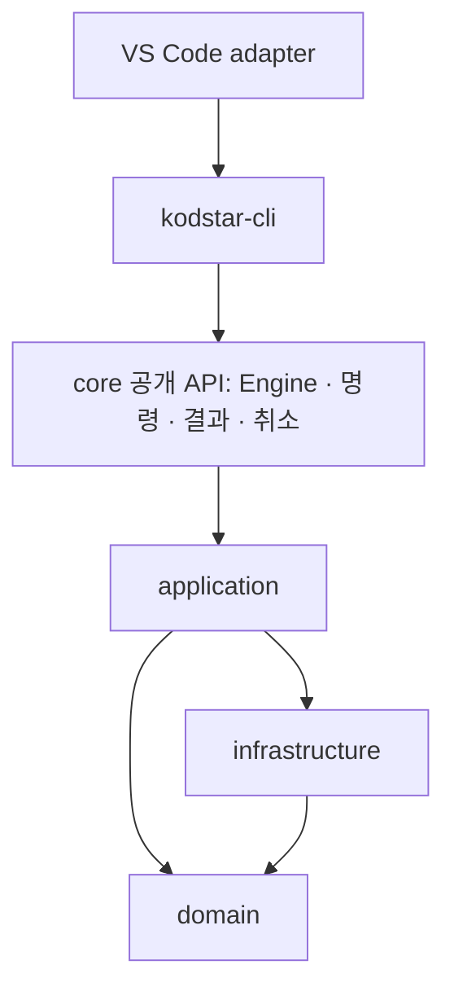

# 코드 아키텍처

이 문서는 현재 코드의 배치, 의존 관계, 실행 흐름과 자원 소유권을 설명한다.
제품 계약은 [기능 명세](../kodstar-spec.md), 개발·검증 절차는 [개발 문서](development.md)에 둔다.

## 레이어와 의존 방향



| 구성 | 책임 |
|---|---|
| `domain` | 객체·사실·관계·조회·결과·오류의 값과 규칙 |
| `application` | 프로젝트 선택, 동기화, 분석 조정, 이름 해석, 조회와 캐시 정책 |
| `infrastructure` | 파일 순회, parser, 입력 포맷, SQLite와 파일 잠금 |
| `kodstar-cli` | 인자·요청 파싱, 엔진 호출, 출력 형식, 진행 표시와 종료 코드 |
| `editors/vscode` | 세션 관리, 관계 목록, 필터와 소스 위치 이동 |

core의 외부 진입점은 [lib.rs](../crates/kodstar-core/src/lib.rs)다.
CLI는 core API를, 에디터는 CLI의 stdio 세션을 이용한다.
core는 `QuerySink`로 구조화된 결과를 전달하고, CLI가 text·JSON·JSONL·TSV로 출력한다.

SQLite 작업의 소유자는 다음과 같다.

| 작업 | 소유 모듈 |
|---|---|
| connection 생성·설정, schema·저장 버전 검사, 파일·사실 저장 | `infrastructure/index` |
| 분석 transaction과 세대 공개 | `application/analysis` |
| 이름 해석 SQL, 후보·조회 의존·관계 생성 | `application/analysis/resolve` |
| 객체 선택·관계 조회·탐색 SQL | `application/query` |

분석·조회 모듈은 실행 문맥의 connection을 빌린다. SQL과 connection 타입은 core 내부에서 사용한다.

## 소스 구성도

주요 경로를 표시한 구성도이며, `crates/kodstar-core/src` 기준이다.

```text
src/
├── lib.rs
├── domain/
│   ├── facts.rs                 # 추출한 scope·정의·binding·사용 사실
│   ├── facts/
│   │   └── fingerprint.rs       # 사실·lookup 환경 fingerprint
│   ├── symbols.rs               # 객체와 정의 위치
│   ├── relations.rs             # 관계·방향·해석 상태
│   ├── query.rs                 # 선택자와 조회 옵션
│   ├── results.rs               # 결과·metadata·sink
│   └── resolve/                 # 참조 표현과 이름 공간 규칙
├── application/
│   ├── engine.rs                # 공개 엔진 진입점
│   ├── execution/               # 공통 명령 준비·실행·정리
│   ├── workspace/               # 루트와 설정
│   ├── analysis/
│   │   ├── mod.rs               # 갱신 transaction과 세대 공개
│   │   ├── discovery.rs         # 스캔·변경 판정
│   │   ├── pipeline.rs          # producer·worker·writer 조정
│   │   ├── workers.rs           # parser worker 수명·취소
│   │   ├── batches.rs           # 바이트 한도 내 fact 배치 전달
│   │   ├── incremental.rs       # 보수적인 본문 재해석 조건
│   │   ├── configurations.rs    # 설정과 경로 해석 입력
│   │   ├── dotnet_projects.rs   # .NET 정적 소속
│   │   ├── swift_projects.rs    # SwiftPM 정적 소속
│   │   └── resolve/
│   │       ├── mod.rs           # 해석 초기화와 후처리
│   │       ├── facts.rs         # 상속·일반 사실의 순차 해석
│   │       ├── lexical.rs       # lexical binding과 receiver
│   │       ├── modules/         # module 파일·export·후보 수명
│   │       ├── returns/         # 반환 타입과 producer 행
│   │       ├── python/          # Python 해석 규칙
│   │       ├── javascript/      # JS/TS 경로·package·workspace
│   │       └── cxx/             # C/C++ include·선언 대응
│   ├── query/                   # 선택·조회·디스크 탐색
│   │   └── relationship_rows.rs # 준비된 관계 행 복원
│   ├── cache.rs                 # 명시적 캐시 명령
│   └── maintenance.rs           # 자동 GC 정책
└── infrastructure/
    ├── languages/               # grammar 선택과 capability
    ├── parse/
    │   ├── mod.rs               # AST 순회와 사실 생성 문맥
    │   ├── session.rs           # parser 자원·grammar·취소
    │   ├── forms.rs             # 언어별 scope·선언 dispatch
    │   ├── imports.rs           # import 사실 생성 문맥
    │   ├── python/              # scope·import·export·fixture·decorator
    │   ├── javascript/          # ESM·CommonJS·JSX·decorator·EJS 구문
    │   └── cxx/                 # declarator·선언·소유·include 구문
    ├── formats/
    │   ├── auxiliary/           # manifest·설정·form 입력
    │   ├── xml.rs               # XML project·resource 참조
    │   └── components/
    │       ├── ejs/             # 서버 태그·client script
    │       ├── blade/           # view 지시문·PHP·Livewire
    │       ├── razor/           # C# 코드 영역·지시문
    │       ├── astro.rs         # frontmatter·client script
    │       ├── scripts.rs       # 공통 script 영역 scanner
    │       └── script_facts.rs  # script ID·원본 위치 환산
    ├── index/                   # SQLite 자원·schema·사실 저장
    │   ├── write.rs             # 파일 metadata 저장·정리
    │   ├── facts.rs             # 파일 문맥과 구문 fact 저장
    │   ├── reader.rs            # 객체 SQL·제한된 반복 객체 재사용
    │   ├── previous.rs          # 이전 파일 상태의 준비된 조회
    │   ├── fact_statements.rs   # 고정 statement와 바이트 수명
    │   └── statistics.rs        # 세대와 함께 공개하는 coverage 집계
    ├── cache/
    │   ├── mod.rs               # cache 등록과 lease
    │   ├── catalog.rs           # 디스크 catalog와 순차 조회
    │   ├── inspection.rs        # 안전 검사·용량·스캔 한도
    │   ├── locks.rs             # 파일 잠금
    │   └── removal.rs           # 잠금 아래 재확인·삭제
    └── scan/                    # ignore를 적용한 파일 순회
```

언어 전용 규칙은 각 레이어의 언어 모듈에 둔다. `parse`에는 C#·C/C++·Elixir·Erlang·Go·
JavaScript/TypeScript·Kotlin·Lisp·Pascal·PHP·Python·Ruby·Rust·Scala·Swift·Zig 모듈이 있다.
`resolve`의 언어 모듈은 C/C++·Go·JavaScript/TypeScript·Lisp·PHP·Python·Ruby·Rust·Swift이며,
Kotlin·Scala·Pascal의 개별 해석 파일과 공통 lexical·namespace 규칙이 함께 사용된다.

공통 순회·parser 수명·사실 예산은 `parse`가 관리한다. 언어 모듈은 구문 규칙을,
`resolve`의 언어 모듈은 이름·모듈·멤버 선택 규칙을 담당한다.
혼합 입력의 코드 영역과 원본 위치 대응은 `formats/components`가 관리한다.
행 기반 보조 포맷은 `formats/auxiliary/lines.rs`에서 원본 바이트 위치를 순차 계산한다.

CLI의 코드는 `crates/kodstar-cli/src`에 있다. `args`와 `invocation`은 입력 변환,
`run`은 명령 호출, `output`은 표시, `session`은 stdio 요청과 worker 수명을 담당한다.
에디터 코드는 `editors/vscode/src`, 엔진 회귀 사례는 `crates/kodstar-core/tests/cases`에 둔다.

## 명령 공통 실행

CLI와 stdio worker는 `Engine::execute`를 호출한다. 직접 라이브러리 호출도 같은
`execution::run`을 거친다. `CommandHandler`는 검증·준비 정책·진행 callback·명령 실행을 정의한다.


`execution::Context`가 connection과 lease를 소유하고 동기화와 조회에서 재사용한다.
명령별 최신성 정책과 우회 조건은 [공통 증분 동기화 계약](../kodstar-spec.md#111-명령의-공통-증분-동기화)을 따른다.
watch는 변경 관찰자를 준비한 뒤 초기 동기화하고 같은 실행 문맥에서 갱신을 반복한다.

## 분석과 세대 공개

1. `analysis`가 writer lock 아래 갱신 transaction을 연다.
2. discovery가 파일을 순회하고 metadata·해시·설정으로 파싱 대상을 판정한다.
3. worker가 파일 하나의 소스·AST에서 사실을 추출한다. writer가 이벤트를 받아 저장한다.
4. 완성된 스캔 결과로 삭제를 반영하고 프로젝트·설정 소속을 계산한다.
5. 추출 사실·lookup 환경의 변경 범위를 판정해 필요한 사실을 해석하고 정의·binding·관계·진단·통계·세대를 함께 commit한다.

변경 없는 파일의 사실은 재사용한다. 추출한 사실이 같으면 관계를 유지하고 metadata와 파일 루트 범위만 갱신한다.
이름·서명·binding·모듈 환경이 같은 Rust 단순 함수 본문은 symbol ID를 보존하고 변경 파일의 참조를 재해석한다.
이 경로는 Rust 파일·함수·모듈과 선정한 binding만 있는 인덱스에 적용한다. 정의·import·설정·파일 구성이나
판정 조건이 바뀌면 전체 해석을 수행한다. 성공·실패한 조회 의존성도 해당 참조와 함께 공개한다.
스캔·파싱·해석 실패와 취소는 transaction을 rollback하며 마지막 정상 세대를 남긴다.

## 저장 모델과 이름 해석

영구 테이블은 [schema.sql](../crates/kodstar-core/src/infrastructure/index/schema.sql)에 정의한다.

| 테이블 | 내용 |
|---|---|
| `metadata`, `files` | 프로젝트·공개 세대·설정 fingerprint·파일 상태·모듈·내용·추출·환경 해시 |
| `scopes`, `symbols`, `bindings` | 원래 정의 위치·lexical 환경·이름·명시적 타입·import/export |
| `facts` | 사용 위치와 대상 해석 전의 참조 사실 |
| `symbol_identities` | 구문 정의와 대표 객체의 대응 |
| `relationships`, `lookup_dependencies` | 해석 결과와 성공·실패한 조회 의존성 |
| `diagnostics` | 스킵·분석 한계·오류 진단 |
| `coverage` | 정상 세대와 같은 transaction에서 집계한 입력·객체·관계 통계 |

해석은 상속·구현 관계를 먼저 처리하고 lexical binding·import/export·receiver 근거로
대상을 선택한다. 후보와 외부 참조는 분기별 임시 테이블에서 관리한다.
공유 statement와 임시 후보의 수명은 해석 세대와 lookup 범위에 묶인다.

구문 정의와 대표 객체를 구분해 복수 선언의 위치를 보존한다. 분리된 메서드의 소유자와
dispatch 관계는 해석 단계에서 연결하며, 재사용할 원래 사실의 source를 다른 파일의 객체로 바꾸지 않는다.
base 관계는 후속 해석을 위해 transaction 안에 먼저 기록하고 나머지 관계·조회 의존성은
staging 후 공개한다. override·dispatch 후처리도 같은 transaction에서 끝난다.

## 자원 소유권

| 자원 | 소유자와 수명 |
|---|---|
| cache 경로 | `Engine`; 호출 사이에는 경로만 보관 |
| 프로젝트 lease·connection | `execution::Context`; 한 명령 또는 watch 실행 문맥 |
| writer lock | `execution::Context`의 준비·동기화; 쓰기 작업 범위 |
| transaction | 분석 실행; commit 또는 rollback까지 |
| 소스·변환 버퍼·AST | 파일을 처리하는 worker; 파일 처리 후 해제 |
| parser | worker의 `ParseSession`; 처리할 grammar로 설정해 재사용 |
| fact 배치와 바이트 permit | worker가 제한된 배치를 누적하고 큐에서는 소비 후 해제 |
| 객체 재사용 | 조회의 `SymbolReader`; 최대 2개·합계 64KiB 이내 |
| 읽기 snapshot·frontier·visited | 조회 실행; sink 전송과 탐색이 끝날 때 해제 |
| stdio worker·요청 취소 토큰 | CLI session; EOF·shutdown·취소 후 종료 확인 |
| cache catalog | 캐시 작업; 임시 SQLite에서 항목을 순차 조회한 뒤 해제 |

producer와 worker는 scoped thread 안에서 종료한다. 수신기 guard는 오류·panic 시 취소를 전파하고
수신기를 닫아 대기 중인 sender가 풀리게 한다. 조회의 frontier·visited·정렬과 해석 후보는
SQLite 임시 저장을 사용하며 결과는 행 단위로 sink에 전달한다.

캐시 등록·조회·정리는 registry lock과 프로젝트 lease를 공유한다. 삭제 직전 상태와 잠금을
재확인하고 사용 중인 캐시와 알 수 없는 파일을 보호한다.
