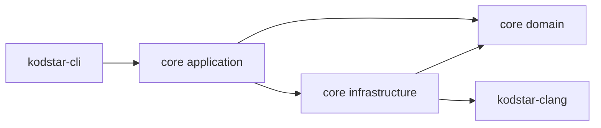
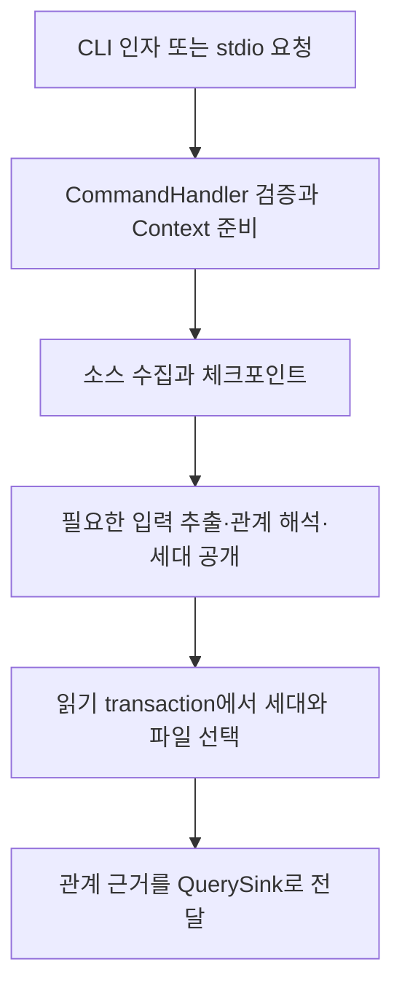

# KodStar 코드 아키텍처

[문서 지도](README.md) · [제품 계약](../kodstar-spec.md) · [개발 환경](development.md)

## 소스 폴더 지도

```text
kodstar/
├── crates/
│   ├── kodstar-cli/
│   │   ├── src/                인자·확인·설치·출력·stdio
│   │   ├── build.rs            실행 파일에 포함할 라이선스 리소스 생성
│   │   └── tests/              공개 명령·출력·프로세스 계약
│   ├── kodstar-core/
│   │   ├── src/
│   │   │   ├── lib.rs          Rust 공개 API
│   │   │   ├── domain/        사실·관계·요청·결과 타입
│   │   │   ├── application/   실행 준비·분석·조회·이력 정책
│   │   │   └── infrastructure/ 파일·parser·SQLite·native·감시 어댑터
│   │   ├── tests/              언어별 근거·증분·일관성 회귀
│   │   └── benches/            엔진 성능 사례
│   └── kodstar-clang/
│       ├── src/                Rust 실행 API·FFI·내장 헤더 읽기
│       ├── native/             C++ frontend·VFS·AST 방문
│       ├── build/              정적 링크 입력과 헤더 리소스 생성
│       └── build.rs            native 빌드 조정
├── scripts/
│   ├── checks/                 작성 규칙·설치·확인·stdio 검사
│   ├── benchmarks/             빌드 간 의미 결과와 비용 비교
│   └── grammars/               고정 파서 소스 재생성
├── vendor/                     패치한 공식 grammar·생성물·출처
├── LICENSES/                   의존성·native 원본의 고지와 출처
└── docs/                       제품 계약과 코드·검증 설명
```

## 레이어의 경계



| 경계 | 소유하는 판단 | 코드 진입점 |
|---|---|---|
| CLI | 옵션 파싱, 사용자 확인, 요청 번역, 출력과 종료 코드 | [main.rs](../crates/kodstar-cli/src/main.rs) |
| 공개 엔진 API | 타입으로 표현한 명령·진행·취소의 호출 경계 | [lib.rs](../crates/kodstar-core/src/lib.rs) |
| 도메인 | 원문 위치, 사실, 객체, 관계 상태, 조회·이력 요청과 결과 | [domain](../crates/kodstar-core/src/domain) |
| 애플리케이션 | 작업 준비, 동기화, 분석·이력·조회 흐름 조정 | [application](../crates/kodstar-core/src/application) |
| 인프라 | 소스 보존·파싱, SQLite·잠금, 파일시스템과 native 경계 | [infrastructure](../crates/kodstar-core/src/infrastructure) |
| 내장 Clang | C/C++ 의미 분석의 FFI, VFS 입력, 리소스 수명 | [kodstar-clang](../crates/kodstar-clang) |

`Engine` 핸들의 장기 상태는 캐시 경로다. DB 연결·잠금·작업 버퍼는 요청과 단계가 소유한다.
CLI와 stdio는 같은 `Command`와 `QuerySink` 경계를 사용한다. 공통 실행기가 요청 준비를 조정하고
분석과 이력의 각 소유자가 결과를 게시한다.

## 일반 조회가 지나가는 경로

예로 `kodstar refs src/api.rs handle --sites`를 따라간다.



1. CLI가 파일·객체·옵션을 `Query::Refs`와 `QueryOptions`로 정규화한다.
2. 공통 실행기가 루트·설정·이력과 인덱스를 연다. 일반 모드는 현재 파일 상태를 먼저 체크포인트로 보존한다.
3. 분석기는 목표 체크포인트를 직전 분석 세대의 입력과 대조한다. 필요한 파일을 추출·해석한 뒤 새 세대를 공개한다.
4. 조회는 하나의 SQLite 읽기 transaction에서 파일 별칭·객체·분석 세대를 고정한다. 역방향 근거를 행 단위로 읽는다.
5. `QuerySink`는 메타데이터와 결과 행, 요약을 받는다. CLI의 formatter는 선택한 형식으로 쓰고 세션 전송은 요청 ID를 붙인다.

`--no-refresh`와 `--rev`는 2~3단계에서 입력 선택과 갱신 정책을 바꾼다.
같은 소스에서 어떤 입력과 분석을 읽는지 구분하려면 [실행 상태](architecture/execution.md#공통-실행기)와
[공개 최신성 계약](reference/storage.md#최신성과-과거-조회)을 함께 본다.

## 여러 언어가 공통으로 사용하는 값

| 값 | 생산자와 소비자 |
|---|---|
| `Snapshot` | 이력 DB가 특정 체크포인트를 가리킨다. discovery, parser 입력과 native include가 이 상태에서 읽는다. |
| `SourceSpan` | 위치의 바이트·줄·열을 표현한다. 인코딩 변환·혼합 코드 투영 뒤에도 원본 위치를 복원한다. |
| `Fact` | 언어별 extractor가 `Definition`, `Scope`, `Binding`, `Use`, `Module`을 만들어 공통 writer에 전달한다. |
| `Symbol`과 관계 | 인덱스가 파일·스코프·소유와 언어 정보를 표현한다. resolver가 대상·상태·규칙과 사용 위치를 채운다. |
| `QueryRow`·`QuerySummary` | 조회와 이력이 결과를 행 단위로 생산하고 소비자가 완료·잘림·범위를 확인한다. |

예를 들어 같은 루트의 Rust·Go·TypeScript는 각각 파일 분류와 언어별 규칙을 거친다. 분석 행의 언어와
패키지·모듈 경계는 유지된다. `overview`는 결과를 한 세대에서 집계하고, 이름 선택과 관계 해석은
해당 언어의 근거를 사용한다. Vue 안의 TypeScript처럼 **한 파일에 여러 구문 구간이 있는 경우**는
먼저 host 파일의 범위를 나눈 뒤 원본 위치로 facts를 되돌린다. 같은 구조가 [입력과 구문 추출](architecture/inputs.md)에 설명돼 있다.

## 코드 읽기 경로

| 관심 동작 | 처음 열 파일과 설명 |
|---|---|
| 인자·요청·동기화·출력 | [명령 실행](architecture/execution.md) |
| 파일이 지원 입력으로 인식되거나 실패하는 과정 | [입력과 구문 추출](architecture/inputs.md) |
| 헤더와 compile 설정을 포함한 C/C++ 호출 해석 | [내장 Clang](architecture/native.md) |
| 이름을 대상에 연결하고 변경을 다시 해석하는 과정 | [이름 해석과 증분 갱신](architecture/resolution.md) |
| 요청에 맞는 인덱스 행을 읽고 제한하는 방법 | [조회와 탐색](architecture/queries.md) |
| SQLite 레이아웃, 원자적 공개, 자원과 잠금 | [인덱스와 캐시](architecture/storage.md) |
| 원문 저장, 체크포인트 비교, checkout 복구 | [이력 구현](architecture/history.md) |
