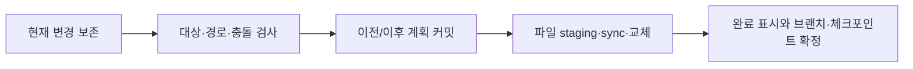

# 원문 수집·이력 비교·복원

[아키텍처](../architecture.md) · [저장 계약](../reference/storage.md) · [분석 인덱스](storage.md)

## 소스 상태를 저장하는 경로

[application/history/mod.rs](../../crates/kodstar-core/src/application/history/mod.rs)가 이력 요청의
작업 순서를 소유한다. [infrastructure/history/mod.rs](../../crates/kodstar-core/src/infrastructure/history/mod.rs)는
`Repository` 연결, 저장소 identity, SQLite 잠금과 유효한 형식을 관리한다.
`Repository::snapshot`이 내주는 `Snapshot`은 DB와 체크포인트 ID를 지정한다.

[capture.rs](../../crates/kodstar-core/src/application/history/capture.rs)가 일반 명령의 동기화와
이력 저장에서 공유하는 수집 진입점이다.

1. 저장소 잠금 아래 `working` catalog와 현재 파일을 대조한다.
   [catalog.rs](../../crates/kodstar-core/src/application/history/capture/catalog.rs)가 이전 상태 조회와 관찰 기록 SQL을 재사용한다.
2. 기본 모드는 크기·변경 시각·권한·종류가 같은 경로를 방문으로 표시한다. 원문 확인이 필요한 파일은
   읽기 전후의 상태를 검사하며 저장 writer에 넘긴다.
3. `observed`에는 변경 가능 상태만 담는다.
   [seen.rs](../../crates/kodstar-core/src/application/history/capture/seen.rs)가 확인한 경로를 제한된 바이트로
   보유한다. 삭제를 대조하거나 예산을 초과하면 경로를 임시 SQLite에 옮긴다.
4. 스캔이 성공한 뒤 추가·수정·삭제를 판단한다. 새 상태가 있거나 첫 수집이면 checkpoint·경로 변화·브랜치
   끝을 한 이력 transaction에서 공개한다. 소스가 같으면 기존 checkpoint를 사용한다.

[history/schema.sql](../../crates/kodstar-core/src/infrastructure/history/schema.sql)의 `working`은
현재 수집 상태이고 `checkpoints`·`branches`·`names`는 계보와 참조다.
[metadata.sql](../../crates/kodstar-core/src/infrastructure/history/metadata.sql)이
공유 경로·이전 이후 blob 속성의 저장 행과 논리 `entries` view를 구성한다.
[checkpoints.rs](../../crates/kodstar-core/src/infrastructure/history/checkpoints.rs)는 이름과 ID의 선택·이름 붙이기를 담당한다.

## 원문 저장

| 코드 | 내용 주소를 다루는 단계 |
|---|---|
| [blobs/writer.rs](../../crates/kodstar-core/src/infrastructure/history/content/blobs/writer.rs) | 64 KiB 이내 원문은 제한 버퍼에서 한 번 해시해 저장한다. 큰 원문은 한 번 읽어 파일 해시와 스트리밍 청크를 만든다. |
| [chunking.rs](../../crates/kodstar-core/src/infrastructure/history/content/chunking.rs), [chunks.rs](../../crates/kodstar-core/src/infrastructure/history/content/chunks.rs) | 큰 원문에서 FastCDC v2020으로 2/8/32 KiB의 최소·목표·최대 경계를 고르고 청크를 공유한다. |
| [encoding.rs](../../crates/kodstar-core/src/infrastructure/history/content/encoding.rs) | 128바이트 이상 후보에서 Zstd level 1 frame과 깊이 1 델타를 검사한다. 32바이트보다 큰 이득이 있을 때 압축을 채택한다. |
| [content/reader.rs](../../crates/kodstar-core/src/infrastructure/history/content/reader.rs), [chunk_read.rs](../../crates/kodstar-core/src/infrastructure/history/content/chunk_read.rs) | 시작 위치의 청크를 찾아 제한된 버퍼에서 복원하고 크기·hash·순서를 검증한다. |

큰 입력은 임시 SQLite에 정수 청크 참조를 쌓고 이력 DB에서 savepoint를 사용한다.
이미 같은 blob 주소가 있으면 임시 준비를 되돌리고 기존 ID를 사용한다.
원문 한 번 읽기, 체크포인트에 주소 붙이기, 이후 파서가 **그 주소의 바이트**를 읽는 과정이 분리된다.
분석은 수집 시 확정한 원문을 끝까지 사용한다.

이력 조회에서 반복되는 기준 청크는 같은 transaction의 검증한 크기·내용 ID를 대조해 제한된 범위에서
재사용한다. 보존 형식이 바뀌면 [maintenance](../../crates/kodstar-core/src/infrastructure/history/maintenance)가
형식별 decoder로 원문과 참조·계보·journal을 검증한다. `repack.rs`는 같은 경로의 앞선 독립 청크를
제한된 개수 비교하고 ID를 유지한 채 표현을 교체한다. 빈 페이지 회수는 변환·재압축 커밋 이후다.

## 시점 사이의 파일 차이

[checkpoints/materialize.rs](../../crates/kodstar-core/src/infrastructure/history/checkpoints/materialize.rs)는
가까운 시점을 현재 구성에서 최대 64개 체크포인트의 변경을 거슬러가거나 적용해 재구성한다.
먼 시점은 해당 조상 변화에서 구성한다.
[history/changes/mod.rs](../../crates/kodstar-core/src/infrastructure/history/changes/mod.rs)와
[route.rs](../../crates/kodstar-core/src/infrastructure/history/changes/route.rs)는 공통 조상 기준으로
변경을 모으고, 필요하면 두 시점의 파일 구성을 정렬 대조한다. 중간에 바뀌었다가 원래 상태인 경로는
최종 delta에서 제외한다. 같은 delta를 분석 입력 선택, 파일 diff와 변경 영향에서 사용한다.

[compare.rs](../../crates/kodstar-core/src/application/history/compare.rs)가 양쪽 blob 상태를 파일 행으로
만들고 [text.rs](../../crates/kodstar-core/src/application/history/text.rs)와 [text/](../../crates/kodstar-core/src/application/history/text)가
검증·공통 구간 제거·행 정렬·스트리밍으로 text diff를 만든다. 이력 목록·브랜치·파일 diff 결과는
고정한 저장소 읽기 transaction에서 스트리밍한다.

## 그래프 비교가 사용하는 분석

1. [graph.rs](../../crates/kodstar-core/src/application/history/graph.rs)가 이력 저장소와 양쪽 체크포인트,
   분석 환경·추출 버전·관계 registry·형식·비교 예산으로 cache key를 만든다.
2. 비교 cache가 없으면 [snapshots.rs](../../crates/kodstar-core/src/application/history/graph/snapshots.rs)가
   호환 가능한 현재 인덱스를 직접 읽는다. 빈 과거 슬롯이 필요하면 SQLite backup을 사용해 현재 세대의
   분석을 복제하고, 필요한 체크포인트를 `past.sqlite`에서 준비한다.
3. [edges.rs](../../crates/kodstar-core/src/application/history/graph/edges.rs)가 각 스냅샷의 사용을
   논리 key와 endpoint·상태별 수, 대표 근거로 묶는다.
   [changes.sql](../../crates/kodstar-core/src/application/history/graph/changes.sql)이 변화 행을 선택한다.
4. 비교를 완료한 후 [cache.rs](../../crates/kodstar-core/src/application/history/graph/cache.rs)의 DB에
   변경과 근거만 원자적으로 교체한다. 같은 쌍은 출력 한도를 달리해 다시 읽을 수 있다.
   출력은 cache 읽기 transaction에서 진행하고 이력 잠금은 먼저 반환한다.

변경 영향은 그래프 diff와 별도 유스케이스다. [두 분석을 탐색하는 조회 코드](queries.md#변경-영향과-설명의-출처)를 참고한다.

## 작업 파일에 반영하는 checkout

[branches.rs](../../crates/kodstar-core/src/application/history/branches.rs)는 브랜치 참조의 생성·삭제·선택을
조정한다. 복원과 전환은 현재 상태를 먼저 보존하고
[checkout/mod.rs](../../crates/kodstar-core/src/infrastructure/history/checkout/mod.rs)의 `start`로 들어간다.

[checks.rs](../../crates/kodstar-core/src/infrastructure/history/checkout/checks.rs)는 경로·파일 상태와
파일시스템을 확인하고 [files.rs](../../crates/kodstar-core/src/infrastructure/history/checkout/files.rs)와
[tree.rs](../../crates/kodstar-core/src/infrastructure/history/checkout/tree.rs)가 파일 교체와 디렉터리 경계를 처리한다.
같은 파일시스템의 rename을 파일 단위로 쓰고 완료 상태를 journal에 남긴다.
`Repository::open`의 복구는 `recover`에서 계획과 실제 파일 상태를 대조한다.
완료된 파일에 외부 편집이 발견되면 해당 충돌에서 처리를 멈춘다. 복원 결과와 이후 분석 결과는
각각의 상태로 보고한다.
