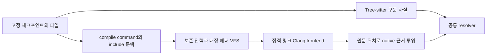

# 내장 Clang의 C/C++ 분석

[아키텍처](../architecture.md) · [빌드 준비](../development.md#개발-환경) · [C/C++ 분석 계약](../reference/analysis.md#불완전-입력과-cc-의미-보강)

## 한 translation unit의 경로

| 코드 | 책임 |
|---|---|
| [parse/hybrid.rs](../../crates/kodstar-core/src/infrastructure/parse/hybrid.rs) | 기본 구문 트리를 먼저 만들고 C/C++ 작업에서 선택적 Clang 분석을 호출한다. |
| [core clang/mod.rs](../../crates/kodstar-core/src/infrastructure/clang/mod.rs) | worker의 `Session`, 고정 `Snapshot`, 파일 단위 분석 결과와 compile database 수명 |
| [configuration.rs](../../crates/kodstar-core/src/infrastructure/clang/configuration.rs), [configuration/](../../crates/kodstar-core/src/infrastructure/clang/configuration) | 파일별 명령 또는 소속 TU 선택, 지원 인자와 VFS 경로 변환 |
| [inputs.rs](../../crates/kodstar-core/src/infrastructure/clang/inputs.rs), [inputs/catalog.rs](../../crates/kodstar-core/src/infrastructure/clang/inputs/catalog.rs) | 경로를 체크포인트에 연결하고 읽은 파일·디렉터리·실패한 경로를 관측한다. |
| [projection.rs](../../crates/kodstar-core/src/infrastructure/clang/projection.rs), [structural.rs](../../crates/kodstar-core/src/infrastructure/clang/structural.rs), [generated.rs](../../crates/kodstar-core/src/infrastructure/clang/generated.rs) | native 선언·사용을 원문 위치·소유자·조건의 근거로 투영한다. |
| [resolve/clang.rs](../../crates/kodstar-core/src/application/analysis/resolve/clang.rs) | callee의 USR·선언 위치를 저장된 객체에 대조하고 include 도달·충돌과 기존 해석 근거를 적용한다. |

`compile_commands.json`은 현재 체크포인트에서 읽는다. `arguments` 배열과 셸 quote를 파싱한
`command`는 허용 인자 목록을 통과한다. include·define·언어 표준과 일부 조건을 만드는 최적화·thread
옵션을 분석 문맥에 전달한다. 입력 가능한 경로는 프로젝트의 `/__kodstar_project/` 아래로 정규화하고
고정 내장 헤더를 별도 VFS 경로로 제공한다. SDK·불명확한 명령에서 충분한 관측을 얻지 못하면 구문
사실을 사용하고 native 진단을 표시한다.

## Rust와 C++의 수명 경계

- [kodstar-clang/src/lib.rs](../../crates/kodstar-clang/src/lib.rs)의 `analyze`가 UTF-8·VFS 경로·인자와
  `Limits`를 검증한 뒤 [ffi.rs](../../crates/kodstar-clang/src/ffi.rs)와
  [bridge.h](../../crates/kodstar-clang/native/bridge.h)의 동기 호출을 사용한다.
- [native/frontend.cpp](../../crates/kodstar-clang/native/frontend.cpp)는 CompilerInstance 문맥,
  flags·token·진단을 관리한다. 시간에 따라 달라지는 전처리 builtin은 확정 근거에서 제외한다.
- [filesystem.cpp](../../crates/kodstar-clang/native/filesystem.cpp)와
  [callbacks.rs](../../crates/kodstar-clang/src/callbacks.rs)는 메모리 VFS와 Rust 입력 공급 계약을 연결한다.
  NUL 종단 버퍼와 해제 callback의 수명은 한 호출 안에서 닫힌다.
- [visitor.cpp](../../crates/kodstar-clang/native/visitor.cpp)가 AST 선언·호출을 방문한다.
  [facts.rs](../../crates/kodstar-clang/src/facts.rs)와 [text.rs](../../crates/kodstar-clang/src/text.rs)는
  반복되는 USR·이름·경로를 파일 내부 사전으로 공유한다. 이 사전의 키는 파일 작업 범위에서 사용한다.
- [model.rs](../../crates/kodstar-clang/src/model.rs)의 `Analysis`가 근거와 완료 상태·제한 이유를 반환한다.
  core는 구문 위치·가시성·조건을 대조한 뒤 의미 결과를 반영한다.

구문 복구 대상인 구조 매크로는 [parse/input/native_session.rs](../../crates/kodstar-core/src/infrastructure/parse/input/native_session.rs)에서
구문상 보호할 이름·범위를 확인한 뒤 원문과 같은 길이의 표시로 보정한다.
[parse/input/](../../crates/kodstar-core/src/infrastructure/parse/input)의 `native_ranges`, `native_types`,
`native_validation`이 겹친 범위·보호할 타입·내부 표식 검증을 나눠 맡는다.
소문자 문장 매크로의 함수형 정의는
[resolve/native_macros/requirements.rs](../../crates/kodstar-core/src/application/analysis/resolve/native_macros/requirements.rs)가
같은 파일 또는 관측 include 경로에서 확인한다. 정보가 부족하면 부분 분석 진단과 후보 관계를 남긴다.

## 작업 예산과 진단

[resources.rs](../../crates/kodstar-core/src/application/analysis/resources.rs)와
[routing.rs](../../crates/kodstar-core/src/application/analysis/routing.rs)가 입력·대기열·DB cache·스택 예약을
뺀 native 작업 공간을 계산한다. native 큐는 입력 하나를 보유하고 16 MiB 스택을 가진 worker가 소비한다.
일반 worker의 스택 크기는 2 MiB다. native worker도 native 대기가 없으면 일반 입력을 처리한다.
파일이 끝나면 native 트리·결과와 부수 입력을 정리하고 해석 단계 전에 모든 worker를 종료한다.

| 한도 | 파일마다 적용하는 값 |
|---|---|
| 원문 입력 | 128 MiB |
| 토큰 수 | 8,388,608개 |
| template 작업 | 1,048,576개 |
| 경로 사용 | 65,536개 |
| native 결과 | 작업에 배정한 바이트의 1/8과 16 MiB 중 작은 값 |

[native/budget.h](../../crates/kodstar-clang/native/budget.h)는 AST·전처리·소스 버퍼 사용량을 관측하여
buffer 여유를 제외한 작업 예산과 대조한다. 관측치와 토큰·template 카운터는 별개다.
이 예산은 단계별 스케줄링에 사용하며 프로세스 전체 RSS는 별도 측정값이다.
문맥 누락·한도 도달은 원인, 위치 또는 부족한 헤더와 관련 사용량을 진단으로 전달한다.

## include 변경과 빌드 산출물

[domain/native.rs](../../crates/kodstar-core/src/domain/native.rs)의 관측 보고는
[index/native.rs](../../crates/kodstar-core/src/infrastructure/index/native.rs)가 분석 세대에 저장한다.
[analysis/native_inputs.rs](../../crates/kodstar-core/src/application/analysis/native_inputs.rs)는 변경 경로와
조상 경로로부터 관측 소비자를 찾고 파일 hash·경로의 존재 여부가 바뀌면 C/C++ 파일을 재파싱한다.
근거가 같은 경우 관측만 교체할 수 있다. 호출 위치가 같아도 실제 callee가 바뀌면 본문 재사용 경계에서
해당 사용을 다시 해석한다.

[build.rs](../../crates/kodstar-clang/build.rs)는 [build/toolchain.rs](../../crates/kodstar-clang/build/toolchain.rs)의
고정 LLVM 탐색과 정적 링크, [build/headers.rs](../../crates/kodstar-clang/build/headers.rs)의 헤더 생성으로 나뉜다.
[build/archives.rs](../../crates/kodstar-clang/build/archives.rs)는 같은 Cargo 출력 경로의 archive 내용 해시를
파일 식별자·크기·수정과 변경 시각으로 재사용한다. [build/compression.rs](../../crates/kodstar-clang/build/compression.rs)는
내장 헤더를 독립 Zstd frame으로 만들고 학습한 사전의 공간 이득을 확인한다.
실행 시 [headers.rs](../../crates/kodstar-clang/src/headers.rs)가 요청한 frame을 직접 메모리에서 복원한다.
엔진·헤더 내용 ID와 target은 분석 환경 fingerprint에 반영된다.
출처와 헤더 버전은 [SOURCE.json](../../crates/kodstar-clang/native/SOURCE.json)에 있다.
